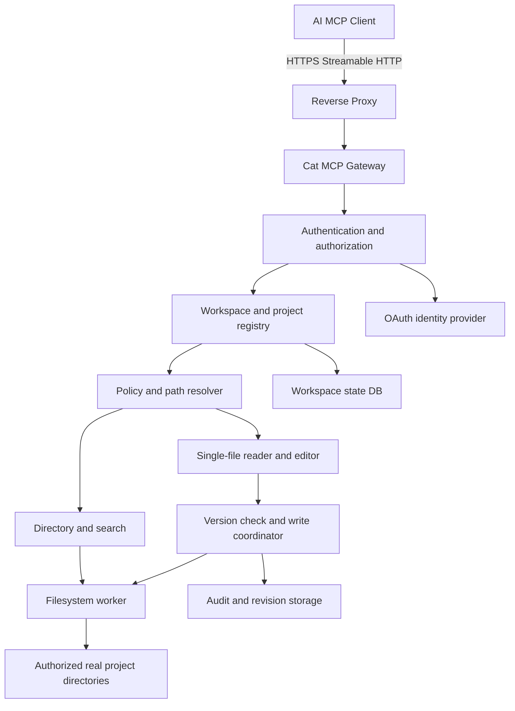

# Cat — 远程软件工程工作空间 MCP 系统设计

## 总述

Cat 是面向 AI 编程的远程工程文件系统 MCP 服务，以 Python 模块化单体实现公网可授权、具备工程上下文、可控上下文开销、单文件可靠写入、可审计恢复的工作空间服务。整体架构以 MCP 协议网关为入口，经身份校验与授权后，通过 Workspace 管理虚拟工作目录，由安全文件层对授权工程目录执行确定性的文件操作。设计遵循"直接依赖成熟通用组件、自主实现业务逻辑"原则，以 fd-relative 路径安全、版本锚点、原子写和操作幂等为一致性保障，默认单进程单 owner 多工程、逻辑隔离，不依赖外部数据库或消息队列。

---

## 1. 修订记录

| 版本 | 日期 | 修订内容 | 修订人 |
|------|------|----------|--------|
| v1.0 | 2026-11-26 | 初始版本，依据《Cat-总体需求与技术实现方案》v1.2 提取系统设计 | - |

---

## 2. 系统架构

系统架构源自方案 §5，整体为分层设计，各层职责如下：

**网关层（Cat MCP Gateway）：**
- 负责 MCP 协议接入与版本协商（Streamable HTTP / SSE）
- Schema 校验、工具发现（tool list）、工具描述注册
- 统一错误格式与响应限制
- 兼容 MCP 2025-era 客户端及后续版本

**身份服务（Authentication & Authorization）：**
- 校验 access token 的签名、issuer、audience、expiry、scope
- 支持标准 MCP OAuth 发现、PKCE、精确 redirect URI
- 禁止客户端自行传递 user_id
- 本地 loopback 可使用受限开发模式，公网必须认证

**Workspace 与工程注册（Workspace & Project Registry）：**
- 维护工程注册表（ID、根路径、策略、generation）
- Workspace 管理：虚拟 CWD、租期、上下文版本
- 不同 AI 分别打开独立 workspace，避免 CWD 串扰
- workspace_id 为不可预测随机 ID，绑定登录主体

**策略与路径解析器（Policy & Path Resolver）：**
- 主体→工程→路径→动作四级鉴权
- 路径安全解析：相对路径转规范相对路径、拒绝越权访问
- symlink/hardlink/special file 防护策略

**目录与搜索服务（Directory & Search）：**
- 层级目录浏览与分页快照游标
- 文件/内容搜索（ripgrep 加速、std 回退）

**单文件读写编辑服务（Single-file Reader & Editor）：**
- 分段读取、版本锚点、精确编辑、统一 diff 补丁
- 保留原编码、换行符、权限

**变更协调器（Version Check & Write Coordinator）：**
- 版本检查与锁：engineering_id + 规范路径为锁键
- 原子写：临时文件 → fsync → 原子 rename → fsync 父目录
- 操作幂等与恢复（PREPARED → COMMITTED → 审计）
- 审计与修订存储

**架构图示（Mermaid，摘自方案 §5）：**



默认单进程、单 owner、多工程，逻辑隔离；公网挂载仅授权目录，专用非 root 用户。MCP server 不使用进程级 chdir。

---

## 3. 技术选型

语言决策与技术栈摘自方案 §3.2。

### 3.1 语言决策

| 维度 | 决策 |
|------|------|
| 主语言 | **Python 3.12+**（CI 首先覆盖 3.12/3.13，实际支持以兼容测试为准） |
| 理由 | 文件、文本、哈希、SQLite 标准库齐全；官方 MCP SDK；易读、快速迭代 |
| 排除 | TypeScript（备选）、Go（仅性能证据支撑时评估）、Rust（不默认）、Shell（仅辅助脚本） |

### 3.2 技术栈

| 技术 | 决策 | 用途 |
|------|------|------|
| MCP | 官方 Python SDK（优先 v2.3.0 候选稳定版内置 MCPServer） | 协议实现、工具注册、传输 |
| HTTP | SDK Streamable HTTP ASGI + Uvicorn | 公网接入，无需额外 FastAPI |
| 数据校验 | Pydantic | 参数校验、配置校验 |
| 配置格式 | TOML（tomllib） | 服务配置，环境变量覆盖敏感配置 |
| 文件操作 | os、pathlib（仅路径表示）、hashlib、difflib、shutil | 底层文件操作，均通过安全文件层封装 |
| 搜索 | ripgrep（可选加速） + std 有界字面量回退 | 工程代码搜索 |
| 状态存储 | sqlite3（WAL 模式） | 工作空间、操作、审计记录 |
| 鉴权 | SDK TokenVerifier + 成熟 OAuth 授权服务 | 身份校验与授权 |
| 工程管理 | pyproject.toml、uv.lock、uv | 包管理与构建 |
| 测试 | pytest、Ruff | 测试与 lint |
| 部署 | uv/systemd/Docker、Caddy/Nginx（可选 TLS 入口） | 生产部署 |

### 3.3 开源参考

Cat 不 fork 单一 MCP 服务、不串联多个完整服务、不复制未经审查的第三方代码。参考项目包括官方 filesystem、j0hanz/filesystem-mcp、tkgstrator/local-mcp、Muvon/octofs、njbrake/filesystem-mcp-server 等，借鉴工具命名、分段读取、精确编辑、流式 HTTP 组织等实践，以统一 Python 代码库自主实现业务逻辑。固定参考版本和全局差异记录见《Cat-开源源码参考基线.md》。

---

## 4. 模块设计

Python 项目结构及模块职责摘自方案 §13。

```text
src/cat_mcp/
```

### 4.1 `__init__.py`
包初始化，定义常用类型重导出。

### 4.2 `__main__.py`
CLI 入口，使用 `cat-mcp` 命令名（避免与系统 `cat` 冲突）。启动 Uvicorn 或 stdio 服务器。

### 4.3 `server.py` — MCP 注册与传输
- MCP 工具注册（`cat_` 前缀，18+ 个工具 handler）
- Streamable HTTP / stdio 双模式传输
- 工具 handler 只做身份上下文提取、参数校验、业务调用及结果映射
- 文件和响应大小限制

### 4.4 `config.py` — 配置校验
- 读取 TOML 配置文件，Pydantic 模型校验
- 服务配置、工程清单、限额、安全策略
- 环境变量覆盖敏感配置（token、密钥等）

### 4.5 `auth.py` — Token 验证和授权
- SDK TokenVerifier 集成
- 四级权限校验：主体 → 工程 → 路径 → 动作
- OAuth 流程支持
- 每次请求独立鉴权，不依靠会话缓存

### 4.6 `projects.py` — 工程注册与发现
- 工程列表查询与生命周期管理
- `list_projects` 仅返回授权工程的 ID、显示名、权限、摘要
- 支持多个 discovery_root 扫描候选

### 4.7 `workspace.py` — Workspace 与虚拟 CWD
- workspace_id 生成（不可预测随机 ID）
- 虚拟 CWD 管理（`set_cwd`、`get_workspace`、`close_workspace`）
- 空闲超时（默认 2h，最长 24h 可配）
- CWD 版本追踪，写操作验证 cwd_version

### 4.8 `schemas.py` — 输入输出模型
- 所有工具请求/响应的 Pydantic 模型
- `request_id`、`workspace_id` 等公共字段
- 路径类型、编辑指令、分页游标等结构化类型

### 4.9 `errors.py` — 统一错误
- 结构化业务错误码与消息
- 错误分类：认证、权限、路径、版本、限额等
- `isError=true` MCP 业务错误

### 4.10 `fs/paths.py` — fd-relative 路径安全
- Linux 安全路径解析层
- 使用 `os.open(..., dir_fd=..., O_NOFOLLOW|O_DIRECTORY)` 逐级打开父目录
- symlink/hardlink/special file 防护
- 拒绝跨工程、越根、URL、NUL、Windows 驱动器等歧义形式

### 4.11 `fs/directory.py` — 树和分页
- 层级目录遍历（depth 0-8，默认 depth=1）
- 分页快照游标（有界快照，过期返回 CURSOR_EXPIRED）
- 默认忽略 node_modules、target、dist、build、.git 及 .gitignore 匹配项
- 条目含 path、name、type、depth、size、mtime、child_count

### 4.12 `fs/reader.py` — 单文件分段读取
- 按行/字节分段读取
- 行号 1-based、闭区间
- 版本锚点（SHA-256 原始字节哈希）
- UTF-8/CRLF/BOM/空文件/超长行支持
- 分段读取中断时返回 `has_more` + `next_start_line`

### 4.13 `fs/editor.py` — 精确替换和单文件补丁
- 支持 `replace_exact`（唯一匹配）、`replace_lines`、`insert_before/after`、统一 diff
- 多个编辑预检全部匹配后才提交，拒绝重叠与模糊匹配
- `dry_run` 模式返回预览 diff
- 保留原编码、换行、权限，禁止无意重编码

### 4.14 `fs/writer.py` — 原子写、移动、回收
- 原子写入：临时文件 → 写/校验 → fsync → 原子 rename（no-replace）
- `create` 要求文件不存在，`replace` 要求旧版本
- 移动锁定源及目的，目录操作使用层级锁/工程级锁
- 删除移至工程专属回收区（外部目录不暴露）
- 恢复禁止覆盖后续外部改动

### 4.15 `fs/search.py` — 有界搜索与 ripgrep 适配
- ripgrep 固定 argv、禁止 shell=True、超时控制
- 标准库回退：有界字面量查询
- 结果路径重验：按统一路径与敏感数据策略过滤
- 不跟随符号链接，禁止 PCRE2 等高风险模式

### 4.16 `state.py` — SQLite 状态管理
- Workspace、Project、Grant、Operation、Revision、Audit 数据模型
- WAL 模式，短事务，不跨线程共享未受保护连接
- 备份状态库的迁移支持

### 4.17 `operations.py` — 锁、版本、幂等、恢复
- 以工程 ID + 规范路径为锁键
- 操作幂等：唯一 `request_id`，重试同参数返回原回执
- 崩溃恢复：重启扫描 PREPARED 状态，判断已提交/未提交/IN_DOUBT
- `get_operation` 查询操作状态

### 4.18 `audit.py` — 审计与历史
- 每次文件操作记录：主体、工程、路径、动作、旧/新版本、字节数、结果
- 审计日志单独存储、权限隔离
- 日志默认不存文件正文、diff、token

---

## 5. 安全设计

安全设计摘自方案 §10。

### 5.1 网络与传输

- 仅开放 443 端口，反向代理到 loopback/private container
- TLS 加密、Host/Origin 校验、请求体上限、认证限速
- 标准 MCP OAuth 发现、PKCE、精确 redirect URI、短期 token、撤销
- 优先成熟 IdP（身份提供商），不自行发明登录协议
- Token 不写入 URL、源码、审计日志
- 健康接口不暴露工程信息

### 5.2 四级权限

| 层级 | 说明 |
|------|------|
| 主体 | 认证后的调用者身份 |
| 工程 | 仅访问已授权工程，管理员注册 |
| 路径 | 仅在授权路径前缀内操作 |
| 动作 | discover / read / write / delete / restore / audit 分离 |

- 默认 deny
- AI 不得扩大授权、修改 Cat 配置或自身权限
- OAuth scopes 与 ACL 取交集
- 每次请求独立鉴权，会话不能替代

### 5.3 OS 隔离

- 非 root 用户运行
- 只挂载指定工程目录
- 独立 UID / 容器化
- 只读系统根、禁止 Docker socket / 宿主 home / SSH 凭据
- Drop capabilities、no-new-privileges、资源配额
- 项目 worker 默认无公网出站
- 禁止任意 shell、任意 URL、动态 mount

### 5.4 敏感文件保护

- 默认 denylist：`.env`（可明确批准 `.env.example`）、私钥、凭证、生产配置、Git 内部配置等
- 搜索、目录、读、写、备份均执行同一敏感文件策略
- 匹配秘密的内容额外阻断或脱敏
- 源代码本身可能包含机密，用户需明确授权数据传输到 AI 服务

### 5.5 Prompt Injection 防护

- 项目文档、源码、注释视为不可信数据
- 文件内的"调用外部工具、上传凭据、修改授权"等文本无授权效力
- 工具只执行受权的结构化操作
- 客户端审批及服务端策略不相互替代

### 5.6 审计

- 记录主体、工程、路径、动作、旧/新版本、字节数、结果、request_id、时间
- 单独存储、权限隔离
- 恢复对象加密或受严格 OS 权限保护，定期清理
- 审计失败时写操作 fail closed 或进入可恢复未决状态

---

## 6. 路径安全设计

路径安全规则摘自方案 §6，必须严格遵循以下五条规则：

### 规则 1：路径参数语义

- 参数 `path` 默认相对 cwd，可用 `path_base=root` 从工程根定位
- 不接受服务器绝对路径、URL、NUL 字符、Windows 驱动器/UNC 等歧义形式

### 规则 2：虚拟 CWD

- CWD 是逻辑路径，不切换系统进程工作目录
- `set_cwd` 支持 `.`、`..` 和子目录，但不得越出工程根
- CWD 改变则旧相对写请求返回 `CWD_CONFLICT`

### 规则 3：路径版本与校验

- 每次返回 `project_id`、`workspace_id`、`cwd`、`cwd_version`、规范化项目相对路径
- 写调用必须传 `cwd_version` 或显式 `path_base=root`

### 规则 4：符号链接与特殊文件防护

- Symlink 默认禁止穿越及写入（可以显示其为链接但不返回外部目标）
- 拒绝特殊设备、FIFO、socket、未获授权子挂载、危险 hardlink
- 使用 fd-relative / openat2 `RESOLVE_BENEATH`、`NO_SYMLINKS`、`NO_MAGICLINKS`（视支持情况）
- Python 使用 `os.open(..., dir_fd=..., O_NOFOLLOW|O_DIRECTORY)` 逐级打开父目录
- 文件操作使用安全目录 fd
- 结合 OS 级隔离、禁止不可信进程搬移根及祖先
- 不满足边界则拒绝公网写

### 规则 5：授权校验全覆盖

- 根目录、目录祖先及目的路径全部授权校验
- 工程根本身不允许删除、移动或覆盖

> **注意：** 仅检查字符串或逐级 fd 并不自动消除挂载及目录重命名竞态。必须结合 OS 级隔离和测试验证。不能仅靠 `realpath` 检查后再按字符串访问。

---

## 7. 配置设计

配置文件格式摘自方案 §12，采用 TOML 格式。

### 7.1 配置模型

| 段 | 字段 | 类型 | 说明 |
|----|------|------|------|
| `[server]` | listen | string | 监听地址与端口，默认 `127.0.0.1:8765` |
| `[server]` | public_url | string | 公网访问 URL |
| `[auth]` | issuer | string | OAuth Issuer |
| `[auth]` | audience | string | Token 预期受众 |
| `[auth]` | require_auth | boolean | 是否强制认证 |
| `[[projects]]` | id | string | 工程标识符 |
| `[[projects]]` | root | string | 工程根路径 |
| `[[projects]]` | access | string[] | 允许动作上限（read/write 等） |
| `[limits]` | directory_depth | integer | 最大目录遍历深度，默认 8 |
| `[limits]` | page_entries | integer | 分页条目数，默认 200 |
| `[limits]` | max_tool_response_bytes | integer | 单次工具响应上限，默认 65536 |
| `[limits]` | max_inline_write_bytes | integer | 内联写入上限，默认 262144 |
| `[limits]` | max_search_seconds | integer | 搜索超时秒数，默认 10 |
| `[limits]` | max_search_results | integer | 搜索结果上限，默认 100 |
| `[limits]` | workspace_idle_seconds | integer | 工作空间空闲超时，默认 7200 |
| `[limits]` | max_concurrent_per_subject | integer | 每主体并发上限，默认 4 |
| `[limits]` | backup_retention_days | integer | 备份保留天数，默认 7 |
| `[security]` | allow_shell | boolean | 禁止任意 Shell，默认 false |
| `[security]` | follow_symlinks | boolean | 是否跟随符号链接，默认 false |
| `[security]` | allow_recursive_delete | boolean | 是否允许递归删除，默认 false |
| `[security]` | deny_sensitive_files | boolean | 敏感文件保护，默认 true |

### 7.2 示例配置（源自方案 §12）

```toml
[server]
listen = "127.0.0.1:8765"
public_url = "https://cat.example.com/mcp"

[auth]
issuer = "https://identity.example.com"
audience = "cat"
require_auth = true

[[projects]]
id = "demo-app"
root = "/srv/cat/projects/demo-app"
access = ["read", "write"]

[[projects]]
id = "demo-lib"
root = "/srv/cat/projects/demo-lib"
access = ["read"]

[limits]
directory_depth = 8
page_entries = 200
max_tool_response_bytes = 65536
max_inline_write_bytes = 262144
max_search_seconds = 10
max_search_results = 100
workspace_idle_seconds = 7200
max_concurrent_per_subject = 4
backup_retention_days = 7

[security]
allow_shell = false
follow_symlinks = false
allow_recursive_delete = false
deny_sensitive_files = true
```

> 实际授权由独立 ACL 配置或管理面定义，`access` 是项目允许动作上限，不是所有人自动获得权限。

---

## 8. 错误处理设计

错误处理规范摘自方案 §11。

### 8.1 统一结果格式

```json
{
  "ok": true/false,
  "request_id": "...",
  "workspace_id": "...",
  "data": { ... },
  "error": {
    "code": "ERROR_CODE",
    "message": "错误描述",
    "retryable": false,
    "details": { ... }
  }
}
```

- MCP 工具业务错误用 `isError=true` 和结构化响应内容
- 认证/协议错误用标准 HTTP / MCP 语义
- 所有结果避免泄露主机绝对路径和内部堆栈

### 8.2 错误码表

| 错误码 | 含义 | 处理方式 |
|--------|------|----------|
| `UNAUTHENTICATED` | 未认证 | 重新认证，不尝试替代路径 |
| `FORBIDDEN` | 权限不足 | 申请合法权限 |
| `WORKSPACE_EXPIRED` | 工作空间超时 | 重新 `open_workspace` |
| `CWD_CONFLICT` | CWD 版本冲突 | `get_workspace` 确认当前目录 |
| `PATH_OUTSIDE_ROOT` | 路径越根 | 拒绝且审计 |
| `UNSAFE_PATH` | 不安全路径（symlink/特殊文件） | 拒绝且审计 |
| `NOT_FOUND` | 文件/路径不存在 | 重新确认路径 |
| `ALREADY_EXISTS` | 文件/路径已存在 | 检查创建模式 |
| `VERSION_CONFLICT` | 文件版本不匹配 | 重新读取并重新生成编辑 |
| `AMBIGUOUS_MATCH` | 编辑匹配模糊 | 收窄匹配锚点 |
| `PATCH_MISMATCH` | 补丁不匹配 | 调整补丁内容 |
| `CURSOR_EXPIRED` | 分页游标过期 | 从新分页快照重启 |
| `TOO_LARGE` | 超出大小限制 | 分块处理 |
| `RATE_LIMITED` | 速率限制 | 按 `retry_after` 重试 |
| `APPROVAL_REQUIRED` | 需要审批 | 等待真实授权 |
| `IDEMPOTENCY_CONFLICT` | 幂等冲突（复用 ID 承载不同请求） | 不复用 ID |
| `IN_DOUBT` | 操作状态不确定 | 查询操作并管理员恢复，禁止盲重试 |

### 8.3 错误处理原则

- **认证/授权错误**：不泄露项目存在性或内部路径
- **路径错误**：不泄露合法性之外的路径信息
- **冲突错误**：提供可操作的恢复指引
- **IN_DOUBT**：唯一需要人工介入的错误状态，禁止自动重试
- **RATE_LIMITED**：支持 `retry_after` 字段指示等待时间
