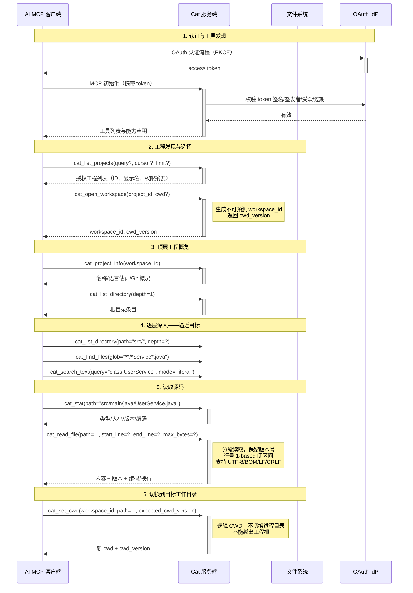
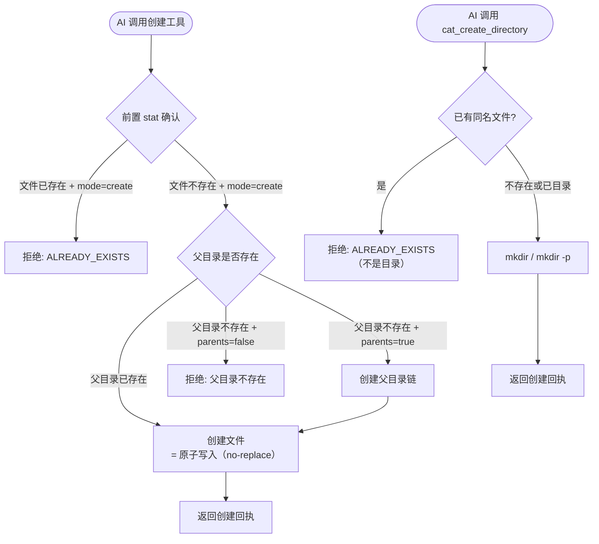
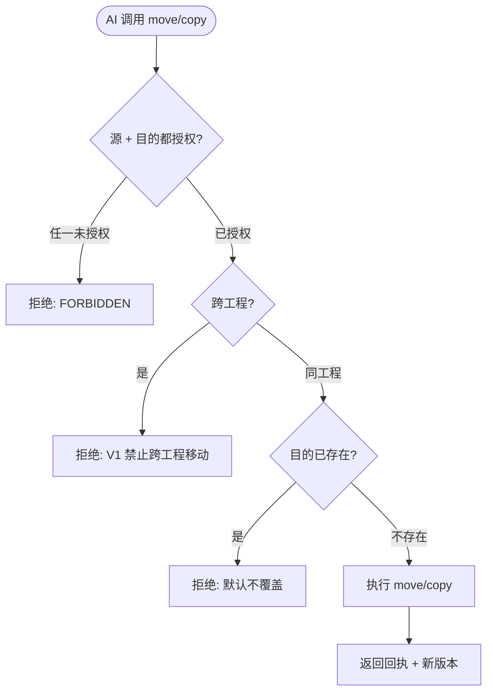
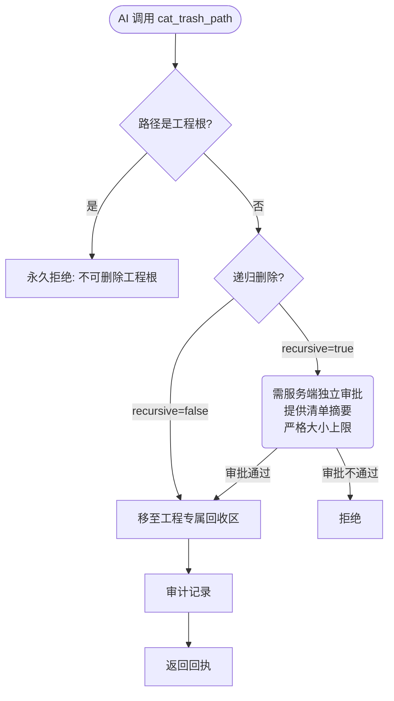
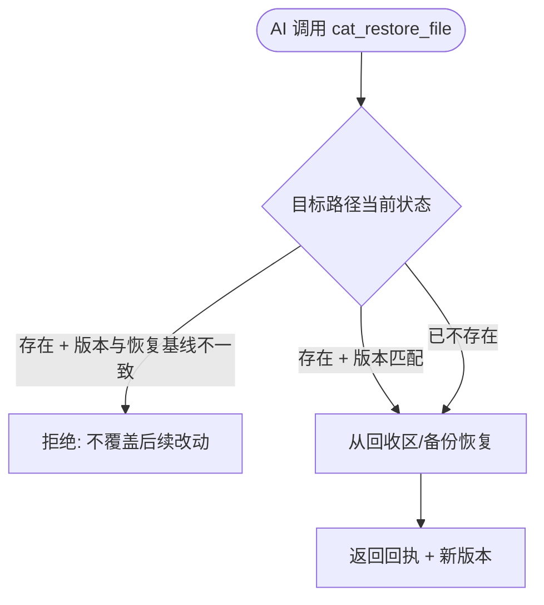
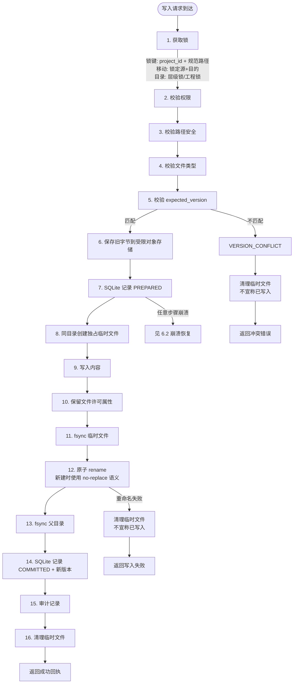
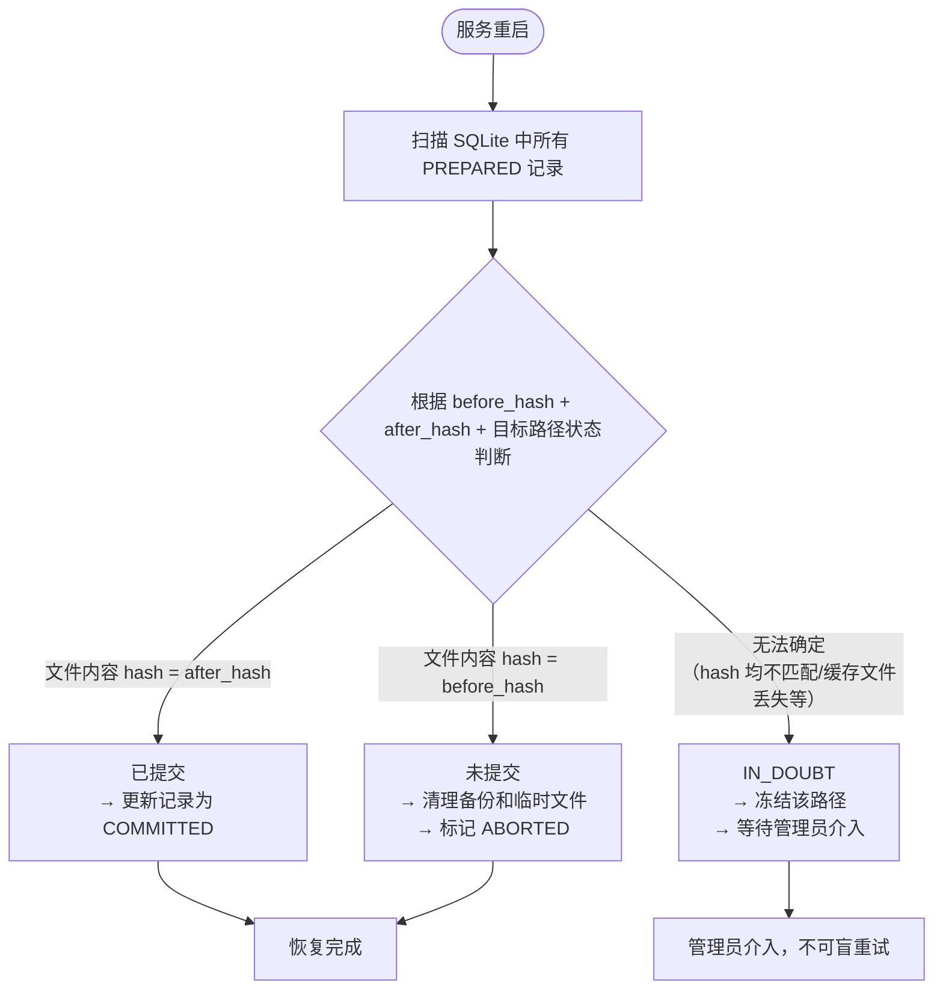
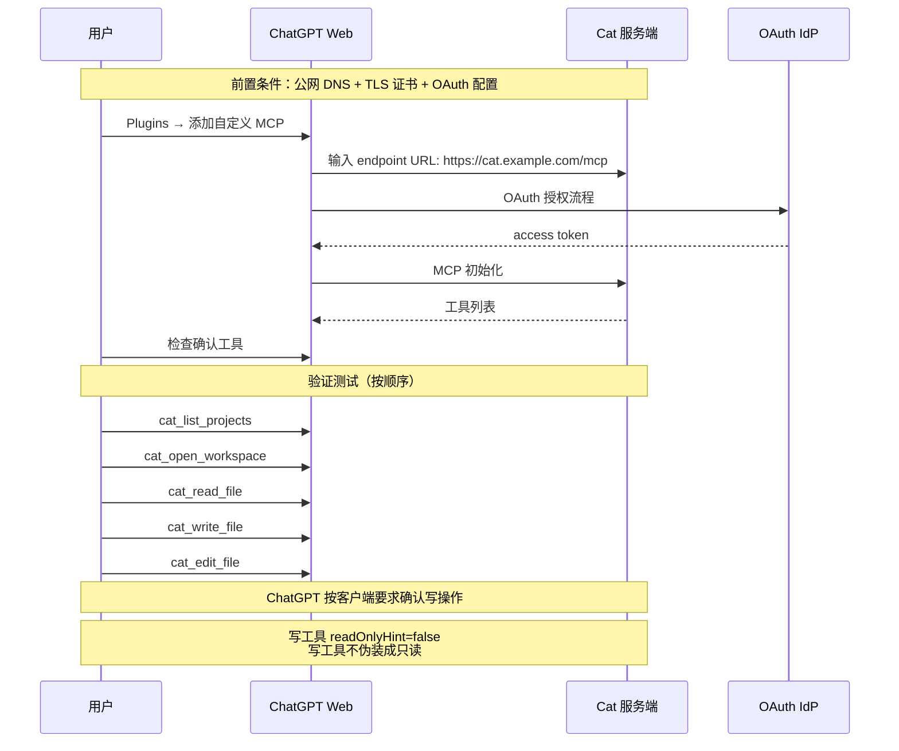
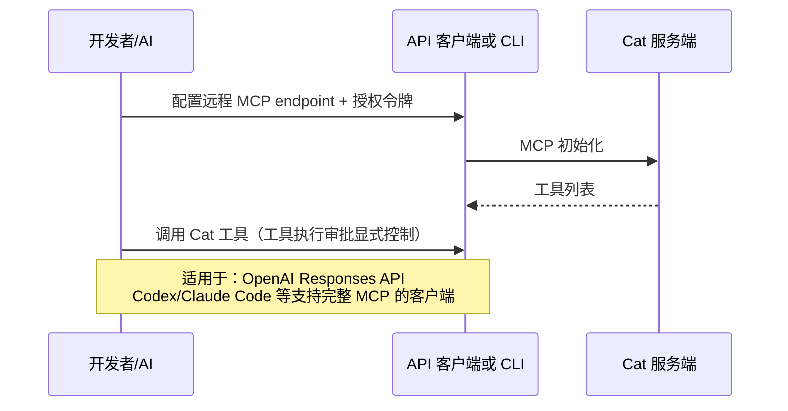
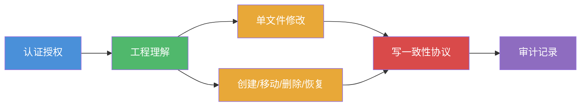

# D-核心业务流程

## 总述

Cat 的核心业务场景是：AI MCP 客户端（如 ChatGPT、Claude Code 等）通过公网 HTTPS 远程访问服务器上授权的工程目录，完成"理解工程结构 -> 定位目标代码 -> 精确修改文件"的完整闭环。服务端负责确定性执行文件操作，客户端负责分析、设计和编程决策，两者通过 MCP 工具契约协同工作。

主体间交互关系：

- **AI MCP 客户端**：发起工具调用，驱动业务前进，编排多步任务
- **Cat 服务端**：验证授权、执行文件操作、维护版本与一致性、记录审计
- **文件系统**：真实工程目录，被 Cat 以安全路径层保护性访问
- **OAuth IdP**：提供身份认证，签发和校验 token

所有写操作遵循"锁定 -> 校验 -> 备份 -> 原子写入 -> 审计"的一致性协议，确保网络中断、并发冲突和进程崩溃场景下不静默破坏文件。

---

## 1. 修订记录

| 版本 | 日期 | 修订说明 | 修订人 |
|------|------|----------|--------|
| v1.0 | 2026-11-26 | 初稿，基于 v1.2 总体需求方案 §8、§9 及 §4、§10 提取 | Cat 文档 |

---

## 2. 业务参与角色

| 角色 | 说明 | 职责 |
|------|------|------|
| AI MCP 客户端/用户 | ChatGPT、Claude Code、Codex 等调用 Cat MCP 工具的 AI 代理或人类用户 | 分析代码、设计修改、编排任务流、确认审批 |
| Cat 服务端 | 公网 MCP 服务，负责文件操作、状态维护与一致性保障 | 鉴权、路径安全、文件读写、版本管理、锁与事务、审计 |
| 文件系统 | 服务器上授权的真实工程目录 | 存储文件内容、提供 fd-relative 安全路径操作能力 |
| OAuth IdP | 外部身份提供商（如 GitHub OAuth） | 签发和验证 access token，确认主体身份 |

---

## 3. 工程理解流程

**源文档：§8.1**

AI 客户端从未知工程开始，逐步定位到目标代码文件，是后续一切修改的前置步骤。



### 关键决策点

| 决策点 | 条件 | 结果 |
|--------|------|------|
| 工程是否授权 | list_projects 返回值 | 未授权工程不返回任何信息 |
| workspace 是否过期 | 每次调用校验 | WORKSPACE_EXPIRED，需重新 open |
| cwd 版本变更 | set_cwd 后旧相对路径写请求 | CWD_CONFLICT |
| 路径是否安全 | 逐级 dir_fd + O_NOFOLLOW 校验 | UNSAFE_PATH / PATH_OUTSIDE_ROOT |

### 数据一致性保障

- workspace 绑定登录主体，不同 AI 即使同一账号也独立 workspace
- 每次请求重验授权和工程 generation
- cwd 变更后旧请求被拒绝，防止混淆工作目录
- 读取时 expected_version 可传入，中途内容改变则返回 VERSION_CONFLICT

---

## 4. 单文件修改流程

**源文档：§8.2**

AI 客户端对一个已知版本的文件执行精确编辑或覆盖写入，是 Cat 最核心的写操作路径。

```mermaid
sequenceDiagram
    participant A as AI MCP 客户端
    participant C as Cat 服务端
    participant FS as 文件系统
    participant SQL as SQLite 状态库

    Note over A,SQL: 主路径：正常修改
    A->>+C: cat_read_file(path, expected_version?)
    C->>FS: 授权分段读取
    FS-->>C: bytes
    C-->>-A: text + 版本 V1

    A->>+C: cat_edit_file(dry_run=true, expected_version=V1, edits)
    Note right of C: 内存中校验所有匹配<br/>拒绝重叠范围、模糊替换<br/>不修改工程
    C-->>-A: diff 预览 + 匹配摘要

    A->>+C: cat_edit_file(request_id, expected_version=V1, edits)
    Note right of C: 进入写入一致性协议（详见 §6）

    C->>SQL: 工程 + 路径级锁定
    SQL-->>C: 锁获取

    alt 版本未变化
        C->>FS: 保存旧文件副本到备份存储
        C->>SQL: 记录 PREPARED
        C->>FS: 创建临时文件 → 写入 → fsync → 原子 rename
        C->>FS: fsync 父目录
        C->>SQL: 记录 COMMITTED + 新版本 V2
        C-->>-A: 回执 + request_id + 版本 V2

        Note over A,C: 确认回读
        A->>+C: cat_read_file(expected_version=V2)
        C-->>-A: 确认内容一致
    else 外部已修改
        C-->>-A: VERSION_CONFLICT
        Note over A: 重新读取当前版本<br/>重新设计编辑策略<br/>不自动覆盖
    end

    Note over A,SQL: 处理路径：版本冲突
    A->>+C: cat_read_file(path)  ← 重新获取最新版本
    C-->>-A: text + 版本 V2'
    A->>C: cat_edit_file(dry_run, expected_version=V2', ...)
    A->>C: cat_edit_file(request_id, expected_version=V2', ...)
    Note right of C: 以新版本为基线重试
    C-->>-A: 成功回执或再次冲突
```

### 网络中断与幂等重试

```mermaid
sequenceDiagram
    participant A as AI MCP 客户端
    participant C as Cat 服务端

    Note over A,C: 场景：提交 edit_file 后网络中断
    A->>+C: cat_edit_file(request_id="r_abc", ...)
    Note over A: 网络断开等待超时

    Note over A: AI 恢复连接后：
    A->>+C: cat_get_operation(request_id="r_abc")
    alt request_id 已执行并提交
        C-->>-A: 已完成 + 回执 + 版本 V2
    else request_id 在执行中（PREPARED）
        C-->>-A: 进行中 + 状态
        Note over A: 等待或稍后重试
    else request_id 不存在
        C-->>-A: 未知
        Note over A: 可安全重试（使用同一 request_id）
    end

    Note over A,C: 关键规则
    Note left of A: 同 request_id + 同参数 = 原回执<br/>同 request_id + 不同参数 = IDEMPOTENCY_CONFLICT<br/>不同 request_id + 同请求 = 二次写入（危险）
```

### 关键决策点

| 决策点 | 条件 | 结果 |
|--------|------|------|
| expected_version 是否匹配 | 与文件系统当前内容 SHA-256 比较 | 匹配则继续，不匹配则 VERSION_CONFLICT |
| dry_run 模式 | 参数 dry_run=true | 只预览不修改，提交时重新校验版本 |
| 编辑匹配约束 | replace_exact 必须唯一匹配、不重叠 | 不满足则 AMBIGUOUS_MATCH / 明确错误 |
| request_id 幂等 | 同 ID 同参数 | 返回原回执不二次写入 |
| 写模式 create vs replace | 文件已存在 + create | ALREADY_EXISTS |
| write_file 无条件覆盖 | 未传 expected_version | 拒绝（不提供 force） |

### 数据一致性保障

- 每个写操作绑定唯一 request_id，支持幂等重试
- 版本校验（SHA-256）确保操作基于最新内容
- 原子 rename 确保临时文件写入不破坏原文件
- 写入完成后回读确认（AI 主动调用）
- 冲突时不自动覆盖，由 AI 重新设计操作
- 跨文件修改由 AI 编排，不作多文件原子事务声明

---

## 5. 创建/移动/删除/恢复流程

**源文档：§8.3**

### 5.1 创建文件/目录



### 5.2 移动/复制



### 5.3 删除（回收区模式）



**回收区规则**：
- 删除默认移至工程专属回收区（外部目录，不经 MCP 暴露）
- 非立即物理删除
- 递归目录删除需服务端独立审批、清单摘要和严格大小上限
- 删除路径本身不可删除
- 回收区清理由管理员计划执行

### 5.4 恢复



### 关键决策点

| 决策点 | 条件 | 结果 |
|--------|------|------|
| 创建前确认 | stat 确认文件不存在 | 已存在 + create → ALREADY_EXISTS |
| 父目录检查 | 创建时检查父目录存在 | 不存在 + 无 parents → 拒绝 |
| 移动/复制是否覆盖 | 目标已存在 | 默认拒绝，不提供 force 覆盖 |
| 跨工程移动 | V1 限制 | 直接拒绝 |
| 路径是否为工程根 | 路径等于工程根 | 永远不可删除、移动或覆盖 |
| 恢复版本冲突 | 当前已有后续修改 | 拒绝恢复，防止覆盖 |
| 递归删除安全门 | recursive=true | 需独立审批 + 清单 + 上限 |

### 数据一致性保障

- create 使用 no-replace 语义的原子写入
- 删除不立即物理删除，可恢复
- 恢复操作检查当前版本，不覆盖后续变更
- 所有操作走完整权限校验链

---

## 6. 写入一致性流程（原子提交协议）

**源文档：§9**

Cat 的写入一致性协议确保单文件写入在并发、崩溃、网络中断等场景下不静默破坏文件。

### 6.1 正常写入事务



### 6.2 崩溃恢复



### 6.3 并发边界说明

| 情形 | Cat 保障 | 边界/风险 |
|------|----------|----------|
| 多个 Cat 客户端并发写同一文件 | Cat 内锁 + 版本校验确保只有一方成功 | 无 |
| 操作系统本地进程（IDE 等）并发编辑 | 无约束 | 写入前版本核验能检测部分冲突，但存在极窄 TOCTOU 窗口 |
| POSIX rename + compare-and-swap | 无通用原子 CAS | 外部编辑者需要统一协调协议 |
| 共享 live workspace 模式 | 替换前核验、写后检查、保留备份 | 不能承诺绝对无冲突 |

### 6.4 备份管理

| 属性 | 值 |
|------|-----|
| 备份路径 | 工程外独立存储 |
| 备份保留周期 | 7 天（建议默认值） |
| 备份配额 | 按数据策略调整 |
| 存储限制 | 默认不限但可配置配额；超量返回错误及重试建议 |

### 关键决策点

| 决策点 | 条件 | 结果 |
|--------|------|------|
| 锁键范围 | 单文件 = project_id + 路径；移动 = 源+目的；目录操作 = 层级锁 | 稳定顺序避免死锁 |
| PREPARED 后崩溃 | 重启后扫描 PREPARED | 判断已提交/未提交/IN_DOUBT |
| IN_DOUBT 处理 | hash 均不匹配 | 路径冻结，管理员介入 |
| 临时文件失败 | 任意步骤失败 | 清理临时文件，不宣称写入 |
| 外部编辑 | 本地进程不遵守 Cat 锁 | TOCTOU 窗口，无法严格保证 |

---

## 7. 权限校验流程

**源文档：§10 §7**

四级校验 + 默认 deny 策略，每次工具调用均需完整走通。

```mermaid
flowchart TD
    Start([请求到达]) --> L1{一级: 主体校验}
    L1 -->|token 有效 + 签名/签发者/受众/scope 校验通过| L2
    L1 -->|无效/过期/被撤销| Reject1[拒绝: UNAUTHENTICATED]

    L2{二级: 工程校验} -->|主体在该工程有授权 Grant| L3
    L2 -->|无对应 Grant| Reject2[拒绝: FORBIDDEN]

    L3{三级: 路径校验} -->|路径在 allowed_prefixes 内<br/>+ 安全路径检查|x26a0; 需同时满足
    L3 -->|路径越权或拒绝列表命中| Reject3[拒绝: FORBIDDEN / UNSAFE_PATH]

    L4{四级: 动作校验} -->|discover/read/write/delete/restore/audit<br/>动作权限匹配| Allow[允许执行]
    L4 -->|动作不被 Grant scopes 覆盖| Reject4[拒绝: FORBIDDEN]

    Note over Start,Allow: 敏感文件 denylist 额外过滤<br/>.env/私钥/凭据/生产配置/Git 内部配置等<br/>搜索/目录/读/写/备份统一执行
```

### 权限分离粒度

| 权限 | 对应工具举例 |
|------|-------------|
| discover | cat_list_projects |
| read | cat_read_file, cat_list_directory, cat_search_text, cat_stat, cat_project_info |
| write | cat_write_file, cat_edit_file, cat_apply_patch, cat_create_directory, cat_move_path, cat_copy_file |
| delete | cat_trash_path |
| restore | cat_restore_file |
| audit | cat_list_changes, cat_diff_file |

### 关键规则

- 默认 deny，未显式授权即为拒绝
- OAuth scopes 与 ACL 取交集，两者都必须通过
- 会话不能替代每次鉴权
- AI 不得扩大授权、修改 Cat 配置或自身权限
- 敏感文件 denylist 在所有工具中统一执行
- 审计失败时写操作 fail closed 或进入可恢复未决状态

---

## 8. 客户端接入流程

**源文档：§4**

Cat 提供两条客户端接入路线，取决于用户的 ChatGPT 账户等级及客户端类型。

### A 路线：ChatGPT 原生 MCP（优先路线）



### B 路线：API / 其他客户端（备选路线）



### 协议与传输

| 属性 | 说明 |
|------|------|
| 传输协议 | Streamable HTTP |
| 会话模型 | Cat workspace_id 是业务级上下文，与协议连接 ID 分离 |
| 持久化假设 | 不依赖 MCP session header 存在或会话持久化 |
| 授权审批 | 客户端不支持 elicitation 时返回结构化错误 |
| 兼容性 | MCP 2025-era 客户端及后续版本须经集成测试 |

### 关键决策点

| 决策点 | 条件 | 结果 |
|--------|------|------|
| 账户是否支持自定义写 | ChatGPT Plus vs Business/Enterprise/Edu/Pro | Pro 只读，Business+ 完整读写 |
| B 路线账户场景 | 当前网页对话不支持自定义写入 | 改用 API 或其他客户端 |
| 写工具审批 | 客户端/服务端共同控制 | 写操作需显式确认 |
| 工具注解伪装 | readOnlyHint/destructiveHint | 按真实语义配置，不规避审批 |

---

## 附：流程间依赖关系



- **认证授权**是所有业务的前置依赖
- **工程理解**是文件修改和创建的前置依赖（必须先定位目标文件及其版本）
- **单文件修改**和 **创建/移动/删除/恢复** 共享同一套写入一致性协议
- **审计记录**是所有写操作的最终落点
- 跨文件修改不声明多文件原子事务，由 AI 客户端逐文件编排

---

*本文档对应源 `docs/Cat-总体需求与技术实现方案.md`，各章节编号以 v1.2 版本为准。*
