# D-核心业务流程

> 版本：v1.1（设计审查修订；尚未实现）
> 依据：总体方案 v1.2、A/B、C/E/F、开发实施计划及 CAT-01–40。

## 总述

Cat 的核心业务场景是：AI MCP 客户端（如 ChatGPT、Claude Code 等）通过公网 HTTPS 远程访问服务器上授权的工程目录，完成"理解工程结构 -> 定位目标代码 -> 精确修改文件"的完整闭环。服务端负责确定性执行文件操作，客户端负责分析、设计和编程决策，两者通过 MCP 工具契约协同工作。

主体间交互关系：

- **AI MCP 客户端**：发起工具调用，驱动业务前进，编排多步任务
- **Cat 服务端**：验证授权、执行文件操作、维护版本与一致性、记录审计
- **文件系统**：真实工程目录，被 Cat 以安全路径层保护性访问
- **OAuth IdP**：提供身份认证，签发和校验 token

所有写操作遵循"锁定 -> 校验 -> 备份 -> 原子写入 -> 审计"的一致性协议，确保网络中断、并发冲突和进程崩溃场景下不静默破坏文件。

---

## 1. 修订记录

| 版本 | 日期 | 修订说明 | 修订人 |
|------|------|----------|--------|
| v1.0 | 2026-11-26 | 初稿，基于 v1.2 总体需求方案 §8、§9 及 §4、§10 提取 | Cat 文档 |
| v1.1 | 2026-11-26 | 对齐客户端契约、权限与事务状态机；修正创建、恢复、崩溃和分块流程 | 设计复审 |

---

## 2. 业务参与角色

| 角色 | 说明 | 职责 |
|------|------|------|
| AI MCP 客户端/用户 | ChatGPT、Claude Code、Codex 等调用 Cat MCP 工具的 AI 代理或人类用户 | 分析代码、设计修改、编排任务流、确认审批 |
| Cat 服务端 | 公网 MCP 服务，负责文件操作、状态维护与一致性保障 | 鉴权、路径安全、文件读写、版本管理、锁与事务、审计 |
| 文件系统 | 服务器上授权的真实工程目录 | 存储文件内容、提供 fd-relative 安全路径操作能力 |
| OAuth IdP | 经 CAT-05/06 核验支持目标 MCP 授权流程的外部身份提供方 | 签发和验证 access token，确认主体身份 |

---

## 3. 工程理解流程

**源文档：§8.1**

AI 客户端从未知工程开始，逐步定位到目标代码文件，是后续一切修改的前置步骤。

下图为授权工程的主路径。括号中省略的公共参数仍按 C 校验；P1 工具仅在相应功能交付后可调用。

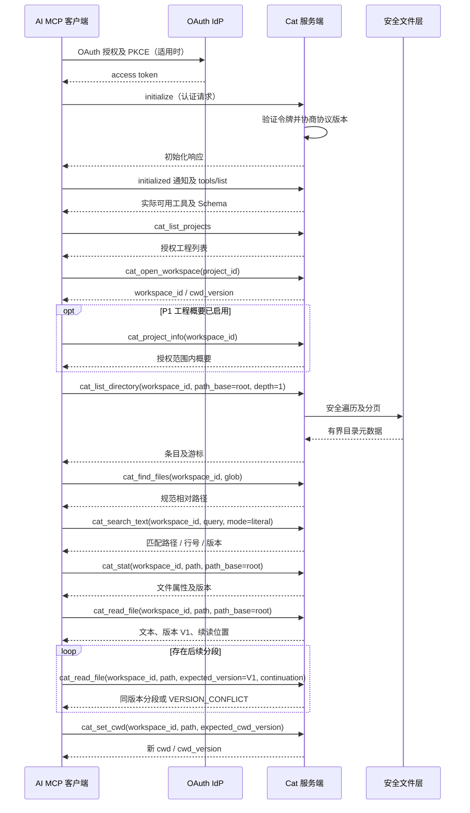

continuation 表示 C 文档中的 start_line 或 byte_offset；不是新增参数。返回的工程相对路径再次调用时显式 path_base=root。未启用 P1 时直接使用目录、查找及读取。

### 关键决策点

| 决策点 | 条件 | 结果 |
|--------|------|------|
| 工程是否授权 | list_projects 返回值 | 未授权工程不返回任何信息 |
| workspace 是否过期 | 每次调用校验 | WORKSPACE_EXPIRED，需重新 open |
| cwd 版本变更 | set_cwd 后旧相对路径写请求 | CWD_CONFLICT |
| 路径是否安全 | 逐级 dir_fd + O_NOFOLLOW 校验 | UNSAFE_PATH / PATH_OUTSIDE_ROOT |

### 数据一致性保障

- workspace 绑定登录主体，不同 AI 即使同一账号也独立 workspace
- 每次请求重验授权和工程 generation
- CWD 变更后旧相对变更请求被拒绝；显式 root 定位不依赖 CWD
- 读取时 expected_version 可传入，中途内容改变则返回 VERSION_CONFLICT

---

## 4. 单文件修改流程

**源文档：§8.2**

AI 客户端对一个已知版本的文件执行精确编辑或覆盖写入，是 Cat 最核心的写操作路径。

读取、预览和正式提交必须绑定同一原始版本；所有正式变更使用 C 的幂等键和公共授权上下文。预览不是提交或审批。

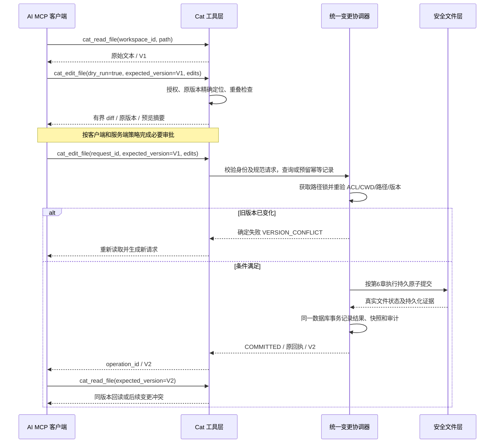

### 网络中断与幂等重试

断线后先查询原工作空间与请求 ID，而非重新生成 ID。对未确认提交的请求，必须区分未受理、处理中与未决。

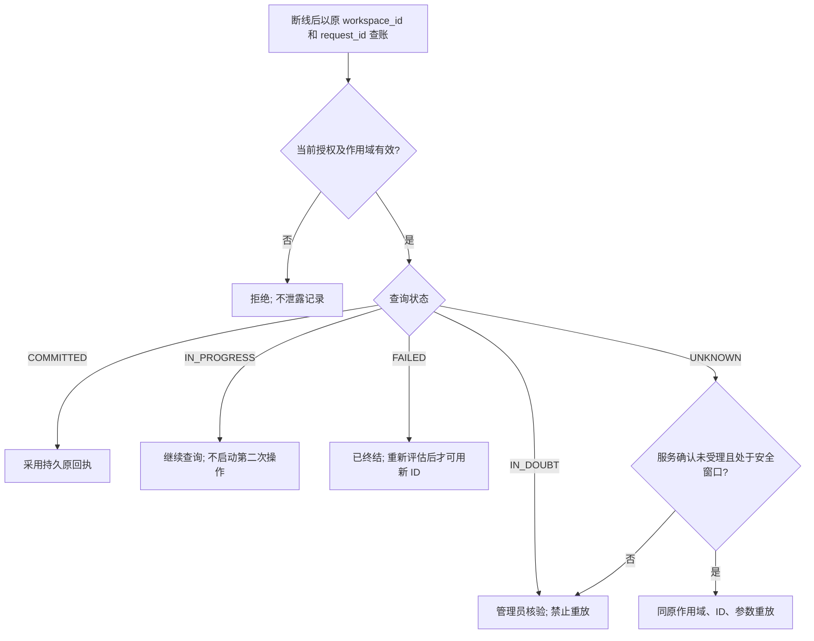

同 ID 同参数仅查回执；不同参数返回 IDEMPOTENCY_CONFLICT。已受理请求保存首次规范路径，重放不得因 CWD 变化转向别处。原 workspace 过期/关闭时仅允许 C 定义的授权查账例外；不得借查账恢复写权限。

### 关键决策点

| 决策点 | 条件 | 结果 |
|--------|------|------|
| expected_version 是否匹配 | 与文件系统当前内容 SHA-256 比较 | 匹配则继续，不匹配则 VERSION_CONFLICT |
| dry_run 模式 | 参数 dry_run=true | 只预览不修改，提交时重新校验版本 |
| 编辑匹配约束 | replace_exact 必须唯一匹配、不重叠 | 不满足则 AMBIGUOUS_MATCH / 明确错误 |
| request_id 幂等 | 同 ID 同参数 | 返回原回执不二次写入 |
| 写模式 create vs replace | 文件已存在 + create | ALREADY_EXISTS |
| write_file 无条件覆盖 | 未传 expected_version | 拒绝（不提供 force） |

### 数据一致性保障

- 每个写操作绑定唯一 request_id，支持幂等重试
- 版本校验（SHA-256）确保操作基于最新内容
- 原子 rename 确保临时文件写入不破坏原文件
- 写入完成后回读确认（AI 主动调用）
- 冲突时不自动覆盖，由 AI 重新设计操作
- 跨文件修改由 AI 编排，不作多文件原子事务声明

---

## 5. 创建/移动/删除/恢复流程

**源文档：§8.3**

### 5.1 创建文件/目录

文件创建与目录创建是两个独立工具。父目录不存在时先明确调用 create_directory，不将 parents 参数传给 write_file。

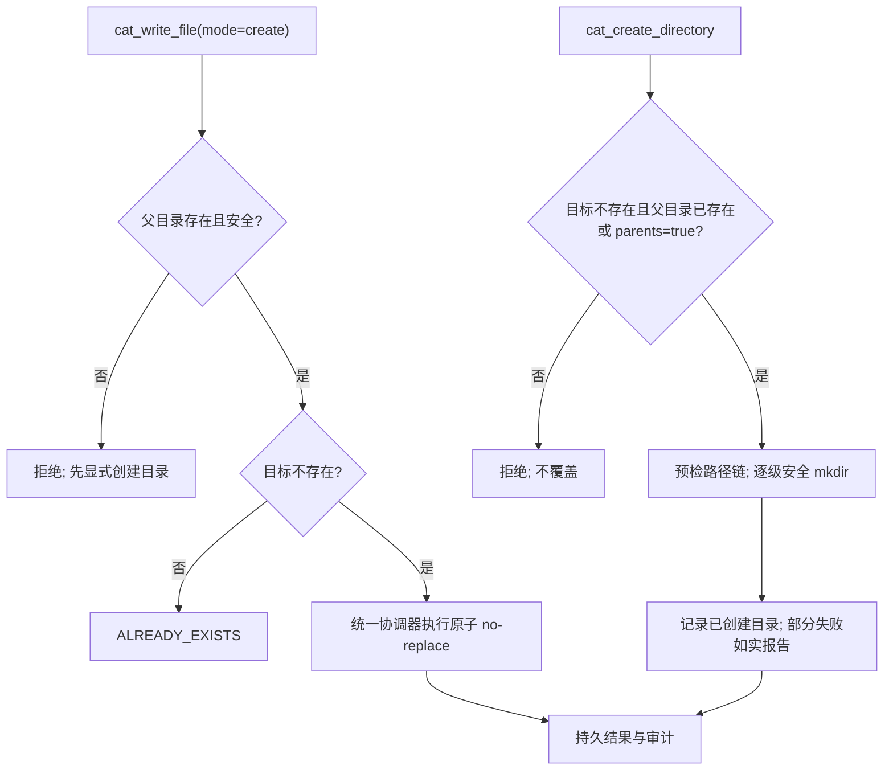

### 5.2 移动/复制

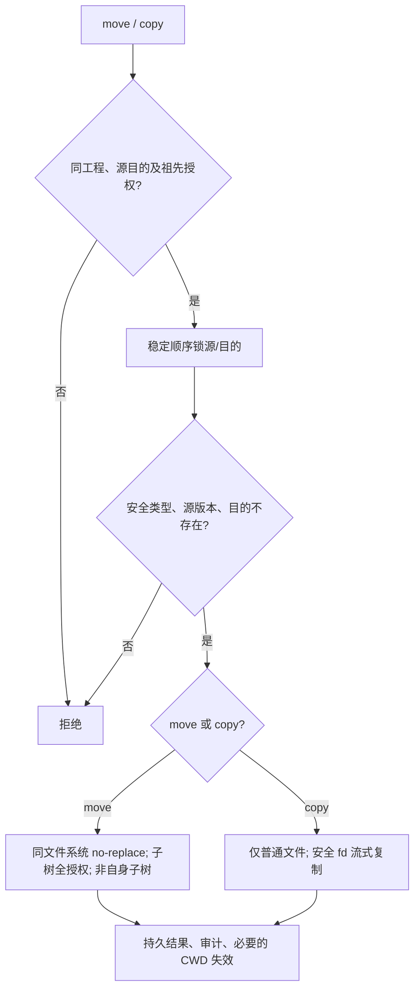

### 5.3 删除（回收区模式）

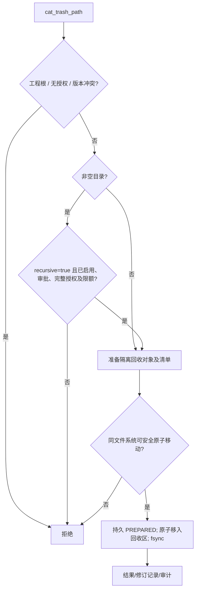

回收区在工程外，禁止 MCP 直接访问。工程根不可删除、移动或覆盖；递归目录删除默认禁用。管理员按保留期和配额清理；P1 的 MCP 恢复只支持单文件，目录回收材料由管理员处理。

### 5.4 单文件恢复（P1）

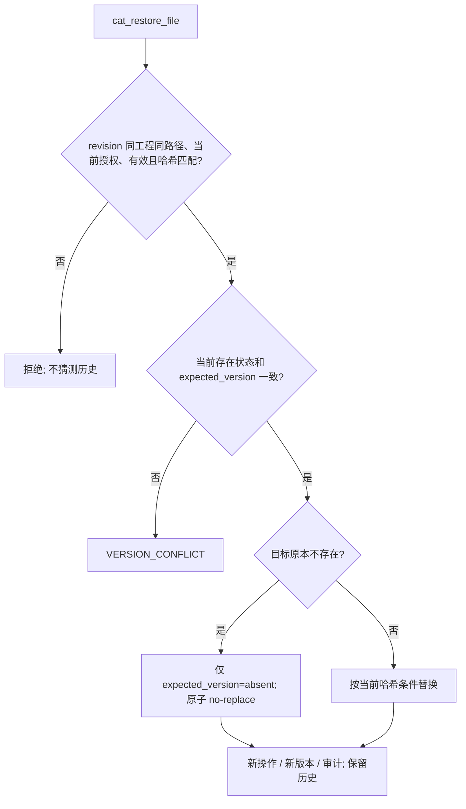

所有路径操作都使用第6章协调器；move/trash 的目录版本与完整子树清单遵循 C。不同操作的预期前后状态必须分别记录，不把删除、目录创建、移动或复制简化成单文件覆盖。复制不改变源；移动/trash 必须对源与目的（包括内部回收对象）状态同时验证。多级 mkdir 不能保证跨目录事务，明确记录实际新增路径与部分失败。

---

## 6. 写入一致性流程（原子提交协议）

**源文档：§9**

Cat 的写入一致性协议确保单文件写入在并发、崩溃、网络中断等场景下不静默破坏文件。

### 6.1 正常写入事务

统一状态机与 E/F 一致：RESERVED → PREPARED → COMMITTED / FAILED / IN_DOUBT。FAILED 仅表示确认终止（包括明确记录的 mkdir 部分效果）；可能已改变目标且无法确认的情况不得当作 FAILED。锁由单进程协调器管理，不是 SQLite 路径锁。SQLite 短事务不跨文件 I/O；同步模式 FULL。所有正式 mutation 共用此协议。

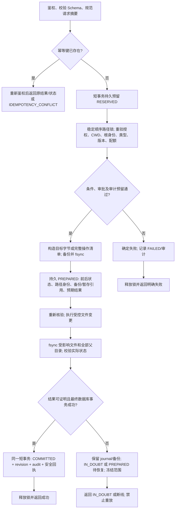

旧内容备份、暂存对象及其目录需先可靠持久化；PREPARED 必须在第一次可能改变工程目标的操作前持久化完整可恢复清单（包括预期 after 版本，不能等 rename 后才计算）。普通文本/二进制写使用同目录独占临时文件，保留必要属性、fsync、原子 rename/no-replace，再 fsync 父目录。移动跨父目录时同步两个父目录；软删除回收区必须满足同文件系统及持久清单要求。无需生成文件的操作按实际类型执行。若 rename 前失败且确认没有目标变更，才能确定 FAILED；rename 后 fsync 或 DB 提交失败属于可能变更，必须保持未决并阻止进一步写。清理失败不得把已提交结果改写成失败。

### 6.2 崩溃恢复

启动前恢复扫描覆盖 RESERVED、PREPARED 和 IN_DOUBT；禁止在恢复检查完成前开放受影响范围。依据持久 journal 中工程 generation、根身份、源/目的、before/after 清单、对象身份、预期存在性和备份/暂存证据判断，而非仅看目标 hash。

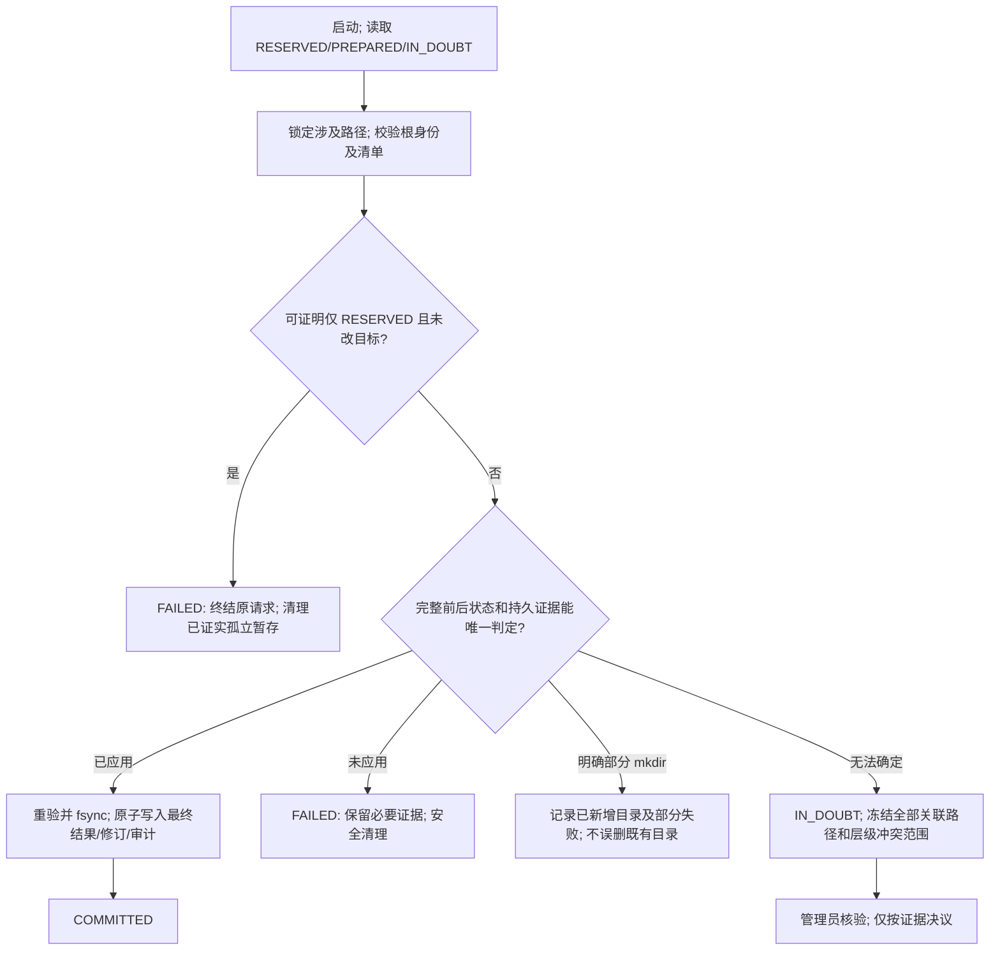

before/after 相同的无实质变化、路径被重建、外部修改、清单不全或审计未能落盘时不能以 hash 相等自动宣称成功。已知无变化的操作可在变更前直接持久终结为 COMMITTED（no-op 回执），不做不必要的 rename。目录操作按身份和完整清单验证，不能安全判定则冻结。管理员决议也必须留下审计与结果，不能删除未决记录或盲目覆盖。

### 6.3 并发边界说明

| 情形 | Cat 保障 | 边界/风险 |
|---|---|---|
| 多个 Cat 客户端同版本写入 | 共享锁、版本及条件检查；实际不同内容变更最多一方成功 | 相同内容 no-op 可成功，不表示第二次实际写入 |
| 本地 IDE 或外部进程 | 写前再核验、写后校验及备份 | 非协作进程不受 Cat 锁约束，存在 TOCTOU |
| 严格生产模式 | 专用受控工程/隔离工作树或统一写协调 | 无法满足 OS 边界时拒绝公网写 |
| 共享 live workspace | 明确告知风险并由维护者协调 | 不承诺绝对无丢失或 POSIX 通用 CAS |

### 6.4 备份、清理与幂等保留

备份对象位于工程外，严格 OS 权限或加密；默认保留7天，配置有限正数配额，不允许默认无限。保留期不能直接删除未决事务、活动上传或仍被引用的对象。清理按状态、引用、期限和配额锁定执行，保留历史元数据并标记快照不可用。幂等回执与备份保留分开；在 workspace 仍可提交或存在未决操作时不得移除请求键。过期窗口外不允许从 UNKNOWN 推断可以重放；优先保留最小请求墓碑，防止重新执行。

### 6.5 分块传输（P1，CAT-33）

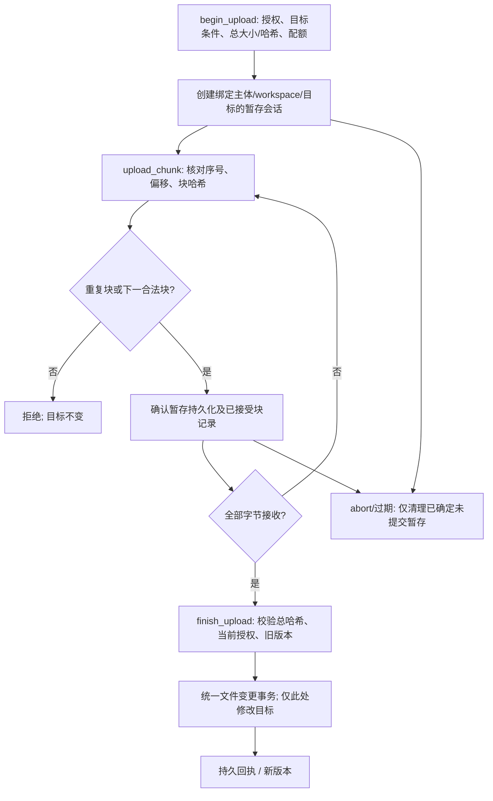

每次操作重验会话绑定、租期和配额；重复块必须相同，断线或重启按持久块清单与暂存内容恢复，不确定时拒绝继续/保留未决提交。finish 绑定唯一正式请求 ID；不得把最后一个 upload_chunk 当作自动提交。下载 read_chunk 以原始版本固定字节范围和校验，版本变化必须重新开始。

---

## 7. 权限校验流程

**源文档：§10 §7**

四级校验 + 默认 deny 策略，每次工具调用均需完整走通。

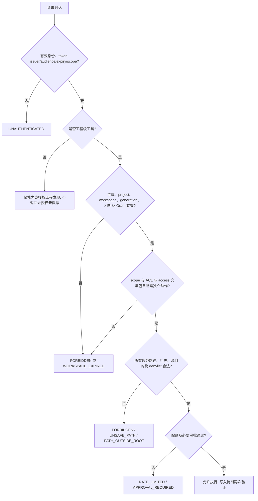

open_workspace 尚无 workspace；由有效主体和项目授权建立。get_operation 的历史只读例外按 C，不得重开权限。拒绝事件也记录脱敏审计；访问前必须完成路径策略，允许文件中命中秘密才拦截或脱敏。

### 权限分离粒度

| 权限 | 对应工具举例 |
|------|-------------|
| discover | cat_list_projects |
| read | cat_read_file, cat_list_directory, cat_search_text, cat_stat, cat_project_info |
| write | cat_write_file, cat_edit_file, cat_apply_patch, cat_create_directory, cat_move_path, cat_copy_file |
| delete | cat_trash_path |
| restore | cat_restore_file |
| audit | cat_list_changes |
| read（含历史路径授权） | cat_diff_file、cat_get_operation、cat_git_status、cat_git_diff、cat_read_chunk |
| workspace | cat_set_cwd、cat_close_workspace |

### 关键规则

- 默认 deny，未显式授权即为拒绝
- OAuth scopes、当前 ACL、项目 access 上限取交集，动作独立不继承；copy 需源 read 与目的 write，move 需源目的 write，restore 需 restore 及对应历史路径授权
- 会话不能替代每次鉴权
- AI 不得扩大授权、修改 Cat 配置或自身权限
- 敏感文件 denylist 在所有工具中统一执行
- 审计失败时写操作 fail closed 或进入可恢复未决状态

---

## 8. 客户端接入流程

**源文档：§4**

Cat 提供两条客户端接入路线，取决于用户的 ChatGPT 账户等级及客户端类型。

### A 路线：ChatGPT 原生 MCP（优先路线）

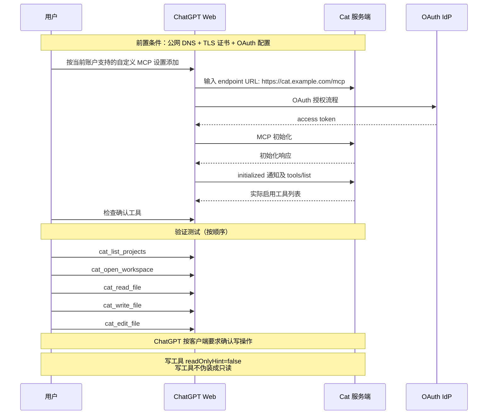

### B 路线：API / 其他客户端（备选路线）

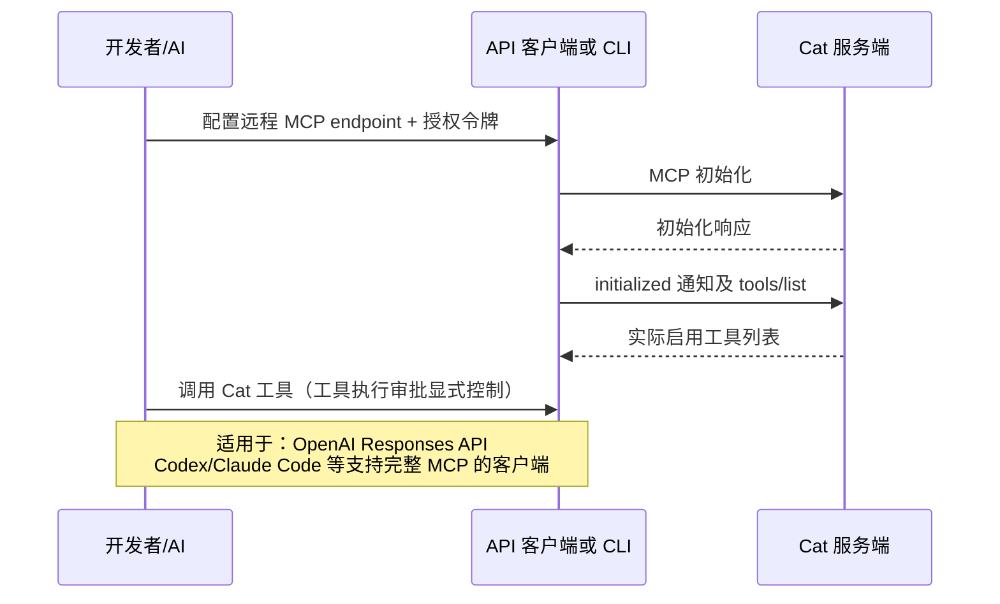

### 协议与传输

| 属性 | 说明 |
|------|------|
| 传输协议 | Streamable HTTP |
| 会话模型 | Cat workspace_id 是业务级上下文，与协议连接 ID 分离 |
| 持久化假设 | 不依赖 MCP session header 存在或会话持久化 |
| 授权审批 | 客户端不支持 elicitation 时返回结构化错误 |
| 兼容性 | MCP 2025-era 客户端及后续版本须经集成测试 |

### 关键决策点

| 决策点 | 条件 | 结果 |
|--------|------|------|
| 账户是否支持自定义写 | ChatGPT Plus vs Business/Enterprise/Edu/Pro | 以目标账户当时权限及 CAT-06 实测为准，不承诺套餐能力 |
| B 路线账户场景 | 当前网页对话不支持自定义写入 | 改用 API 或其他客户端 |
| 写工具审批 | 客户端/服务端共同控制 | 按客户端及服务端真实策略完成必要审批；审批拒绝不改变工程 |
| 工具注解伪装 | readOnlyHint/destructiveHint | 按真实语义配置，不规避审批 |

---

## 附：流程间依赖关系

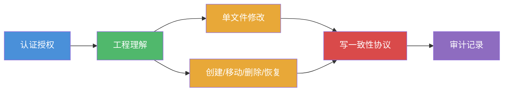

- **认证授权**是所有业务的前置依赖
- **工程理解**通常先于修改；已有可信路径时可直接调用，但服务端始终重验路径、版本或不存在条件
- **单文件修改**和 **创建/移动/删除/恢复** 共享同一套写入一致性协议
- **审计记录**覆盖所有调用及拒绝事件；写入成功前须与最终操作回执一致持久化
- 跨文件修改不声明多文件原子事务，由 AI 客户端逐文件编排

---

*本文档对应源 `docs/Cat-总体需求与技术实现方案.md`，各章节编号以 v1.2 版本为准。*
