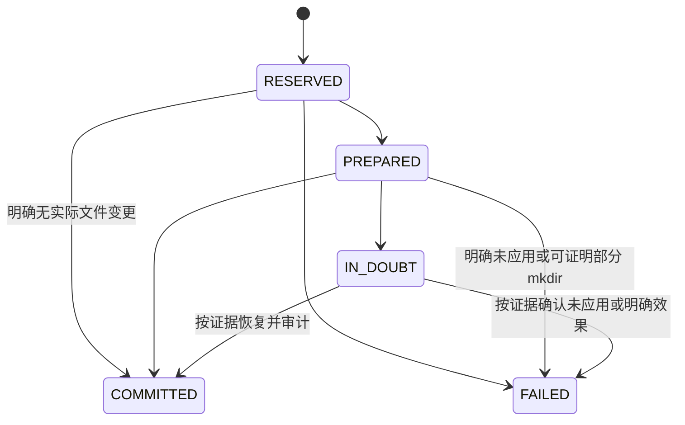

# E-数据模型设计

> 项目：Cat — 远程工程文件系统 MCP 服务  
> 版本：v1.1（设计审查修订；尚未实现）  
> 日期：2026-11-26

## 总述

Cat 以 Project、Grant、Workspace、Operation、Revision、Audit 六个核心实体构成持久业务状态，采用本地 SQLite WAL，状态、备份及审计与工程目录隔离。授权、幂等和事务一致性是设计主线。P1 分块上传增加一个内部 UploadSession 实体，不引入新业务功能或热配置数据库。本文细化总体方案 v1.2 §6、§9–12、B 及 CAT-03/07/09/12/17–19/27/33；表字段与 F 一致，公开工具契约见 C，流程与状态机见 D。

## 1. 修订记录

| 版本 | 日期 | 内容 |
|---|---|---|
| v1.0 | 2026-11-26 | 初稿，提取总体方案数据模型 |
| v1.1 | 2026-11-26 | 修正授权交集、外键、租期、幂等范围、持久恢复清单、快照及审计；补足既有 P1 上传状态 |

## 2. 数据模型总览

六个核心实体共享一个状态数据库，使用物理外键和应用层业务约束相结合，禁止自动级联删除历史；Grant 撤销不删除已存在的 workspace 或历史操作，而是每次重验并拒绝后续访问。P1 UploadSession 绑定原工作空间及目标，不替代文件事务。状态数据不能通过文件工具读取。

| 实体 | 物理表 | 关系及责任 |
|---|---|---|
| Project | projects | 1:N Grant、Workspace、Operation；管理员注册 |
| Grant | grants | (subject, project_id) 唯一；当前有效权限 |
| Workspace | workspaces | 独立 CWD、版本、空闲及绝对期限；1:N Operation |
| Operation | operations | 复合幂等键；RESERVED/PREPARED/终态；1:N Revision/Audit |
| Revision | revisions | 0..N 条快照/路径变更元数据，旧字节对象可选 |
| Audit | audit_log | 0..N 事件；拒绝/发现可无工程、workspace 或 operation |
| UploadSession（P1 内部） | upload_sessions | 工作空间及单目标绑定；分块暂存和最终 Operation 关联 |

主键用 TEXT 非空；Project.id 由管理员配置稳定 ID 或首次生成后持久化（不依赖目录名）；workspace、operation、revision、audit、upload ID 由安全随机生成，不是授权凭据。主体取可信身份提供方标识（issuer 与 subject 的无歧义编码），不接受调用者自行声明。所有数据库时间统一固定宽度 UTC RFC3339 毫秒文本 YYYY-MM-DDTHH:mm:ss.sssZ；客户端可接收相同格式；时钟/期限由服务端管理。

## 3. 核心实体定义

### 3.1 Project（工程）

工程只能由管理员注册、禁用或更新。扫描候选不等于授权。root_path/identity 不对外暴露。

| 字段 | 类型及约束 | 语义 |
|---|---|---|
| id | TEXT PK | 稳定工程标识 |
| display_name | TEXT NOT NULL | 显示名称 |
| root_path | TEXT NOT NULL | 实际根绝对路径，内部专用 |
| root_identity | TEXT NOT NULL | 规范根的设备/inode及适用挂载身份；路径字符串哈希不足以检测重建 |
| enabled | INTEGER 0/1 | 启用标志 |
| policy_id | TEXT NOT NULL | 当前安全策略标识，默认 default |
| access | TEXT NOT NULL | JSON 动作数组；管理员配置上限的已验证快照 |
| generation | INTEGER >=1 | 根、策略、配置授权上限变更递增；旧 workspace 失效 |
| created_at, updated_at | TEXT NOT NULL | UTC 时间 |

配置为真源，启动和受控重新加载时对比并校验；根身份或配置不匹配 fail closed，不自动接受同路径替换。不得删除存在历史引用的工程记录，禁用优先。

### 3.2 Grant（授权）

Grant 是主体在工程内的显式 ACL。有效动作 = token scopes ∩ Grant.scopes ∩ Project.access；无等级继承，也不把 write 隐含成 delete/restore。所有动作必须同时满足路径边界、当前有效期和 denylist。

| 字段 | 类型及约束 | 语义 |
|---|---|---|
| subject | TEXT PK(复合) | 经认证的 issuer+sub |
| project_id | TEXT PK(复合), FK | Project.id |
| scopes | TEXT NOT NULL | JSON 数组，独立动作 discover/read/write/delete/restore/audit/workspace |
| allowed_prefixes | TEXT NOT NULL | JSON 工程相对路径数组；["."] 为明确整个工程，[] 无路径授权，禁止 NULL 默认为全权 |
| expires_at | TEXT NOT NULL | 明确授权期限，过期拒绝 |
| created_at | TEXT NOT NULL | UTC 时间 |

前缀按路径组件边界匹配，而非字符串 startswith；必要的祖先遍历仅限到获授权目标的安全导航，不授权读取其他祖先条目或兄弟目录。路径授权与当前 token/工程状态每次重验；拒绝时不暴露未授权项目存在性。

### 3.3 Workspace（工作空间）

| 字段 | 类型及约束 | 语义 |
|---|---|---|
| id | TEXT PK | 不可预测 workspace_id |
| subject | TEXT NOT NULL | 创建主体 |
| project_id | TEXT NOT NULL, FK | 所属工程 |
| cwd | TEXT NOT NULL DEFAULT '.' | 规范工程相对目录 |
| cwd_version | INTEGER >=1 | CAS 切换版本 |
| project_generation | INTEGER >=1 | 打开时的工程 generation |
| expires_at | TEXT NOT NULL | 当前有效期限=min(空闲期限, absolute_expires_at) |
| absolute_expires_at | TEXT NOT NULL | 创建时确定的最长租期 |
| status | TEXT NOT NULL | active/expired/closed |
| created_at, last_used_at, updated_at | TEXT NOT NULL | 创建/最近成功授权活动/更新 |

默认空闲2小时、最长24小时，可配置；有效活动只刷新空闲截止时间并受绝对期限限制，重启不延长租期。原子 CAS 更新 cwd_version；不自动改变被移动/删除的 CWD，后续相对调用拒绝并要求重新选择目录。关闭/过期后不执行新变更；C 定义的原 workspace 查账例外仅查询已授权操作，不刷新租期。

### 3.4 Operation（操作事务）

| 字段 | 类型及约束 | 语义 |
|---|---|---|
| id | TEXT PK | 不可预测 operation_id |
| subject, project_id, workspace_id | TEXT NOT NULL | 复合 FK 保证 workspace 归属 |
| request_id | TEXT NOT NULL | 客户端稳定幂等 ID；与上述三字段联合唯一 |
| input_digest | TEXT NOT NULL | 规范工具名及完整输入摘要 SHA-256；不存正文或令牌 |
| operation_type | TEXT NOT NULL | write/edit/patch/mkdir/move/copy/trash/restore/begin_upload/upload_chunk/finish_upload/abort_upload |
| path | TEXT NOT NULL | 首次解析的规范主路径 |
| source_path, destination_path | TEXT 可空 | 双路径操作的规范源/目的；单路径无则 NULL |
| project_generation | INTEGER >=1 | 首次受理的工程 generation |
| cwd_version | INTEGER 可空 | 相对变更的上下文版本，root 定位可空 |
| status | TEXT NOT NULL | RESERVED/PREPARED/COMMITTED/FAILED/IN_DOUBT |
| before_version, expected_after_version, after_version | TEXT 可空 | 已核验前版本、预期后版本、实际后版本；不存在/非普通文件按 manifest 表达，非强制 SHA256 |
| manifest_json | TEXT 可空 | PREPARED 前必须完整，记录所有影响路径、前后状态、根/对象身份、存在性、备份/暂存引用及恢复证据 |
| result_json | TEXT 可空 | 终态必须保留安全结果/错误回执，确保同 ID 同参数可返回原结果；无源码、token 或内部路径 |
| bytes | INTEGER >=0 | 操作字节数 |
| started_at, prepared_at, completed_at | TEXT | UTC；started_at 必填，prepared_at 在 PREPARED 写入，终态 completed_at 必填 |

UNIQUE(subject, project_id, workspace_id, request_id)。请求摘要对已验证的结构参数规范化计算，首次路径绑定不因 CWD 改变而重解析；重放需当前授权，不同摘要拒绝。状态不等于客户端查询结果：RESERVED/PREPARED 对外为 IN_PROGRESS；UNKNOWN 仅为无可见记录的查询结果，不存作状态。

状态机：

- RESERVED：已持久占用请求键，不允许更改工程目标。
- PREPARED：首次可能改变目标前已持久记录完整恢复清单、旧对象、预计结果；目标是否已变更仍需核验。
- COMMITTED：实际效果已持久化，最终状态、修订记录、安全回执和最终审计同一 SQLite 短事务提交。
- FAILED：已明确终止，回执含已知效果（如多级 mkdir 部分成功），不代表一切都回滚。
- IN_DOUBT：可能变更但无法确认或最终记录未能提交；冻结全部关联路径，保留恢复材料，等待核验。

manifest_json 采用版本化内部对象（由 CAT-18/19 冻结）：schema_version、operation_type、root_identity、project_generation、paths[]（role/path/before/expected_after：exists/type/version/identity）、backup_refs、staging_refs、操作步骤与预期效果。mkdir 记录每一级预期/实际新增；move/trash 记录源和目标/内部回收对象；copy 记录源不变与目的新建；restore 记录快照和当前不存在或哈希条件。对象引用仅使用服务内部受限键，绝不允许客户端传入路径。不能从文件 hash 相等单独推导操作已执行；未决按 D/F 处理。

### 3.5 Revision（版本快照）

| 字段 | 类型及约束 | 语义 |
|---|---|---|
| id | TEXT PK | 随机 revision_id，授权后才返回 |
| operation_id, project_id | TEXT NOT NULL | 与 Operation 的 ID/工程复合 FK |
| path | TEXT NOT NULL | 该记录对应的规范工程相对路径 |
| before_hash, after_hash | TEXT 可空 | 普通文件原始字节哈希；不存在/目录无普通文件哈希，NULL 合法 |
| before_blob_ref | TEXT 可空 | 旧字节受保护对象键，不对外返回 |
| mode | TEXT NOT NULL | create/replace/edit/patch/mkdir/move/copy/trash/restore |
| availability | TEXT NOT NULL | AVAILABLE/EXPIRED/UNAVAILABLE/NONE，AVAILABLE 才能恢复 |
| bytes | INTEGER >=0 | 旧对象字节数（无对象为0） |
| expires_at, created_at | TEXT NOT NULL | 对象保留期限/创建时间 |

一次操作可有多路径元数据（移动源/目的）；复制源未改变，不必生成源修订。可恢复对象是有 before_hash 且可校验的普通文件旧字节；创建时旧文件不存在，删除后 after_hash 可为空，不声称能恢复不存在的版本。历史查询返回安全元数据和 revision_id，不返回物理引用；过期、缺失、损坏或未保存的内容明确不可用，不能按 hash 伪造正文。历史 diff 可对比当前文件与可用旧字节或经授权 Git 基准。单文件恢复校验同工程、规范路径、根 generation、当前权限及旧字节哈希，并通过新 Operation 提交。清理可去除物理内容并标为 EXPIRED/UNAVAILABLE，保留历史元数据；未决 Operation 引用不得清理。

### 3.6 Audit（审计事件）

| 字段 | 类型及约束 | 语义 |
|---|---|---|
| event_id | TEXT PK | 随机事件 ID |
| subject | TEXT 可空 | 已验证主体；认证失败可空，不存伪造声明 |
| project_id, workspace_id, operation_id | TEXT 可空 | 仅填已核验的真实引用；发现/拒绝可无关联 |
| action | TEXT NOT NULL | 实际工具或内部授权/恢复/清理动作 |
| phase | TEXT NOT NULL | access/prepare/final/recovery；一个操作可多条事件，最多一条 final |
| canonical_relative_path | TEXT 可空 | 经授权规范路径，未知/敏感不存原始字符串 |
| outcome | TEXT NOT NULL | allowed/denied/succeeded/failed/conflict/in_doubt |
| bytes | INTEGER >=0 | 操作或读取字节数 |
| before_version, after_version | TEXT 可空 | 操作前后版本，非文件操作可空 |
| error_code, request_id, correlation_id | TEXT 可空 | 脱敏错误及关联 |
| timestamp | TEXT NOT NULL | UTC |

审计覆盖读/写、拒绝、查询及恢复；最终写入审计必须与状态和回执同一 SQLite 事务。独立审计逻辑表/受限状态目录实现与工程隔离，可另行安全外送；外送不替代持久记录。审计失败在文件未变更时 fail closed，可能已变更则未决。禁止正文、diff、凭据、主机绝对路径和任意原始工具参数。

### 3.7 UploadSession（P1 内部持久状态）

这是 R14/CAT-33 五个分块工具的内部状态，不新增 API 或外部存储服务。

| 字段 | 类型及约束 | 语义 |
|---|---|---|
| id | TEXT PK | upload_id，随机且不是授权凭据 |
| subject, project_id, workspace_id | TEXT NOT NULL | 原主体/工程/workspace 复合 FK |
| project_generation | INTEGER >=1 | begin 时的工程 generation |
| path | TEXT NOT NULL | begin 固定目标相对路径 |
| mode | TEXT NOT NULL | create/replace |
| expected_version | TEXT 可空 | replace 必填，create 表示目标不存在 |
| total_size | INTEGER >=0 | 预期总字节数 |
| file_hash | TEXT NOT NULL | 原始总 SHA-256 |
| staging_ref | TEXT NOT NULL | 工程外受限暂存键 |
| next_chunk_index, next_offset | INTEGER >=0 | 下一预期序号与偏移 |
| chunks_json | TEXT NOT NULL | 有界已接受块清单（序号、offset、长度、hash），无正文 |
| status | TEXT NOT NULL | OPEN/FINALIZING/COMMITTED/ABORTED/EXPIRED/IN_DOUBT |
| finish_operation_id | TEXT 可空 FK | 唯一正式 finish Operation |
| expires_at, created_at, updated_at | TEXT NOT NULL | 租期及时间 |

begin、chunk、abort 的请求回执用 Operation 同一幂等作用域记录；仅 finish 变更真实工程。单上传锁下先持久预备清单，再写/fsync 暂存，再原子登记块及回执；重启核对暂存与清单，不能证明则拒绝继续，未决对象不清理。finish 固定 begin 路径，不按新 CWD 解释；重验原 workspace 有效、项目 generation、ACL、版本和总哈希。块和总大小、清单数量、临时空间及租期均有限；下载不持久化内容，续读带版本。

## 4. 配置模型

配置以管理员控制的 TOML 为唯一持久配置来源，环境变量仅按受支持字段覆盖；不引入数据库热配置或 AI 修改权限。真实配置、IdP 凭据和状态路径不提交公开仓库。CAT-03 完成模型、实际默认值及交叉校验；下列是在 B §7 基础上的必要细化。

### 4.1 `[server]` — 服务端

| 字段 | 类型 | 默认值 | 说明 |
|------|------|--------|------|
| listen | string | `"127.0.0.1:8765"` | 服务监听地址，公网部署建议反向代理监听 443 |
| public_url | string | — | 公网可访问的 MCP endpoint URL，用于 OAuth 重定向及客户端配置 |

### 4.2 `[auth]` — 鉴权

| 字段 | 类型 | 默认值 | 说明 |
|------|------|--------|------|
| issuer | string | — | OAuth issuer 标识，用于验证 access token 的 iss 声明 |
| audience | string | `"cat"` | OAuth audience，校验 token aud 声明 |
| require_auth | boolean | `true` | 是否强制鉴权；仅隔离 loopback 开发可 false，不得经代理公网暴露；公网必须 true |

### 4.3 `[[projects]]` — 工程注册列表

| 字段 | 类型 | 说明 |
|------|------|------|
| id | string | 工程标识符，与 Project.id 对应，不依赖目录名 |
| root | string | 工程真实绝对路径，与 Project.root_path 对应 |
| access | array of string | 该项目允许的动作上限，如 `["discover", "read", "write", "workspace"]`；最终权限取 token scope、Grant.scopes、access 三者交集 |

约束：access 值取值范围同 Grant.scopes：`discover`、`read`、`write`、`delete`、`restore`、`audit`、`workspace`；独立动作，无等级继承。管理员必须显式授权所有实际所需动作。支持多个 discovery_root，由管理员配置且扫描候选默认未授权；批准后才写入 Project。

### 4.4 `[limits]` — 限额与阈值

| 字段 | 类型 | 默认值 | 说明 |
|------|------|--------|------|
| directory_depth | integer | `8` | 目录浏览最大递归深度 |
| page_entries | integer | `200` | 分页单页最大条目数 |
| max_tool_response_bytes | integer | `65536` | 单次 MCP 工具响应最大字节数（64 KiB） |
| max_inline_write_bytes | integer | `262144` | 单次内联写入（非分块）最大字节数（256 KiB） |
| max_search_seconds | integer | `10` | 搜索操作最大耗时（秒），超时明确返回 |
| max_search_results | integer | `100` | 搜索返回的最大匹配结果数 |
| workspace_idle_seconds | integer | `7200` | 工作空间空闲超时秒数（2 小时） |
| workspace_max_seconds | integer | `86400` | 最长租期（24小时），空闲续期不能突破此值 |
| max_concurrent_per_subject | integer | `4` | 每主体最大并发操作数 |
| backup_retention_days | integer | `7` | 备份和快照保留天数 |
| backup_max_bytes | integer | 部署前明确有限正数 | 备份与回收对象总容量；禁止无限 |
| temp_max_bytes | integer | 部署前明确有限正数 | 临时对象容量，含 P1 上传暂存 |
| max_request_bytes | integer | 由 CAT-03/28 按客户端实测确定 | JSON/传输体硬上限，与正文限额及 Base64 膨胀协调 |
| max_search_scan_bytes | integer | 由 CAT-28 实测确定 | 扫描总字节预算 |
| max_scan_entries | integer | 由 CAT-28 实测确定 | 目录/搜索/目录版本清单预算 |
| upload_max_bytes / upload_chunk_max_bytes / upload_max_chunks / upload_ttl_seconds | integer | P1 CAT-33 确定有限正数 | 上传、块、清单及租期限制；未确定前不启用上传 |

### 4.5 `[security]` — 安全策略

| 字段 | 类型 | 默认值 | 说明 |
|------|------|--------|------|
| allow_shell | boolean | `false` | 是否允许任意 Shell 执行（V1 固定为 false） |
| follow_symlinks | boolean | `false` | 是否跟随符号链接（V1 固定为 false） |
| allow_recursive_delete | boolean | `false` | 是否允许递归删除目录（需服务端独立审批） |
| deny_sensitive_files | boolean | `true` | V1 固定 true；仅管理员显式批准非敏感例外（如 .env.example），不可关闭内置安全拒绝 |

---

## 5. 路径模型

客户端使用 C 的统一 path_base：cwd（默认）或 root；根规范表示 "."。返回路径均工程相对，不暴露实际绝对路径。对绝对路径、UNC、URL、NUL、越根路径、特殊文件/链接、危险硬链接及未授权挂载拒绝；允许目录元数据安全显示 symlink 类型但不跟随。规范化仅是逻辑步骤，不代表文件安全：使用受控根 fd、逐级 O_NOFOLLOW/O_DIRECTORY、实际 inode/挂载及授权检查，操作始终使用安全父目录 fd。不得拼接路径后再直接访问，不能依赖进程级 chdir 或单次 realpath。

相对 mutation 必须传 cwd_version；显式 root 无需 cwd_version；source/destination 同一 base。祖先及目的授权、denylist 优先，目录版本采用 C 定义的受限完整清单；不满足完整子树安全约束时拒绝相关目录变更。OS 隔离不足拒绝公网写，外部 IDE 非协调修改的竞态边界见 D。

## 6. 错误模型

C §5 是统一公开错误契约。成功响应 {ok:true,request_id,workspace_id,data}；失败 {ok:false,request_id,workspace_id,error:{code,message,retryable,details}}，未适用的 workspace_id 为 null，data/error 互斥。request_id 对未传的只读请求由服务生成关联 ID，文件变更必须显式给定稳定 ID。仅返回授权上下文，错误不得泄露实际服务器路径、隐藏文件、主体、凭据或堆栈。

| 类别 | 错误码 |
|---|---|
| 身份/授权 | UNAUTHENTICATED、FORBIDDEN、WORKSPACE_EXPIRED、APPROVAL_REQUIRED |
| 参数/路径/状态 | INVALID_ARGUMENT、CWD_CONFLICT、PATH_OUTSIDE_ROOT、UNSAFE_PATH、NOT_FOUND、ALREADY_EXISTS |
| 版本/编辑 | VERSION_CONFLICT、AMBIGUOUS_MATCH、PATCH_MISMATCH |
| 资源/能力 | CURSOR_EXPIRED、TOO_LARGE、RATE_LIMITED、TIMEOUT、CAPABILITY_UNAVAILABLE、UNSUPPORTED_ENCODING、HISTORY_UNAVAILABLE、STORAGE_UNAVAILABLE |
| 幂等及未决 | IDEMPOTENCY_CONFLICT、IN_DOUBT、INTERNAL_ERROR |

retryable 处理与 C 一致，明确失败的写入不自动执行同一请求；IN_DOUBT 禁止盲重试。业务错误使用 MCP isError=true；认证及协议错误使用 HTTP/MCP 语义。审计记录按 §3.6 脱敏。

## 7. 持久化与对外投影

MCP 不暴露原始数据库行。Project 仅授权 ID/摘要；Grant 不直接返回；Workspace 仅授权上下文；Operation 返回查账状态及原安全回执；Revision 返回授权历史 ID 和可用性；Audit 返回精简变更摘要而非原始日志；UploadSession 返回 upload_id、进度、租期和最终回执。所有持久对象与路径均按当前权限重新投影。F 为物理表设计；实施及独立测试按对应 CAT 任务和 G2/G3/G4/G5 门禁，不把本设计当实现结果。
