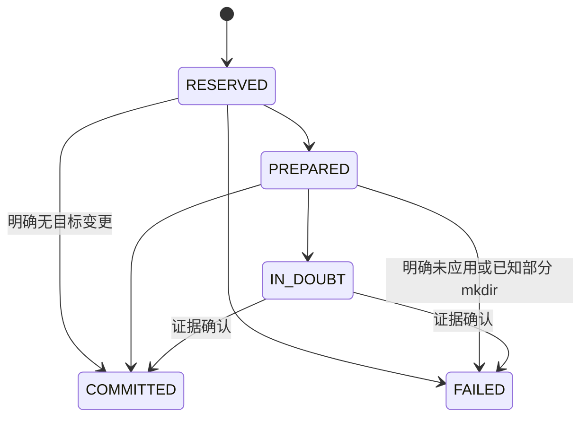

# F-数据库表设计

> 项目：Cat — 远程工程文件系统 MCP 服务  
> 版本：v1.1（设计审查修订；尚未实现）  
> 日期：2026-11-26

## 总述

Cat 使用本地 SQLite 管理六个核心实体（P0），P1 增加 upload_sessions 以持久化既有分块传输需求，共七张业务表。不引入额外数据库、动态配置表或管理界面。本文与 E 的字段、D 的状态机和 C 的工具契约对齐。依据总体方案 v1.2 §6、§9–12、CAT-07/12/17–19/27/33、开发实施计划 G2/G3/G5。DDL 是迁移设计，不代表已经部署。

## 1. 修订记录

| 版本 | 日期 | 修订说明 |
|---|---|---|
| v1.0 | 2026-11-26 | 基于总体方案提炼初稿 |
| v1.1 | 2026-11-26 | 修正外键、精确授权、作用域幂等、状态机、恢复清单、持久回执/审计及 P1 上传；移除超范围热配置表 |

## 2. 数据库概览与连接约束

默认一个 Python 进程、一个本地数据库文件（示例 /var/lib/cat/cat.db），可靠本地磁盘，不使用网络文件系统或多 worker 并发写。审计表与最终事务记录在同一个受限状态数据库，物理备份对象在工程外隔离存储；可另行外送脱敏审计，但不依赖外送完成原子回执。状态库及 WAL/SHM、对象目录均禁止 MCP 直接访问。

每次连接初始化并验证：

```sql
PRAGMA journal_mode=WAL;
PRAGMA foreign_keys=ON;
PRAGMA synchronous=FULL;
PRAGMA busy_timeout=5000;
```

WAL 支持读写并发，写事务仍串行；FULL 是持久日志与终态回执的默认要求，NORMAL 不能保证断电后已提交日志必然持久。连接不可跨线程无保护共享；短事务、参数绑定、有限重试，不持有事务等待网络或文件 I/O。迁移版本由 PRAGMA user_version 管理，CAT-07 实现初始迁移、升级前备份、失败回滚和 foreign_key_check；P1 增加第七表，未完成的工具不启用。

统一约定：所有 ID 为非空 TEXT；只有工程 ID 可由管理员指定稳定值，其他业务 ID 随机生成。subject 为认证后的 issuer+sub 无歧义编码。所有时间由应用以固定宽度 UTC RFC3339 毫秒文本写入，例如 2026-01-01T00:00:00.000Z；SQL 比较统一绑定同格式 :now，不与 datetime('now') 混用。JSON 字段由应用严格校验类型、长度、允许键和枚举，不依赖 SQLite JSON 扩展。DDL CHECK 与 FK 只是结构兜底，不能代替业务授权。禁止级联删除历史。

## 3. 表结构与 DDL

字段含义见 E §3，物理结构、约束和索引见本节。重复启动使用 schema version 判断，不用 IF NOT EXISTS 掩盖不兼容的既有结构。

### 3.1 P0 六张核心表

```sql
CREATE TABLE projects (
 id TEXT PRIMARY KEY NOT NULL,
 display_name TEXT NOT NULL, root_path TEXT NOT NULL, root_identity TEXT NOT NULL,
 enabled INTEGER NOT NULL DEFAULT 1 CHECK(enabled IN (0,1)),
 policy_id TEXT NOT NULL DEFAULT 'default', access TEXT NOT NULL,
 generation INTEGER NOT NULL DEFAULT 1 CHECK(generation>=1),
 created_at TEXT NOT NULL, updated_at TEXT NOT NULL
);
CREATE TABLE grants (
 subject TEXT NOT NULL, project_id TEXT NOT NULL REFERENCES projects(id) ON DELETE RESTRICT,
 scopes TEXT NOT NULL, allowed_prefixes TEXT NOT NULL,
 expires_at TEXT NOT NULL, created_at TEXT NOT NULL,
 PRIMARY KEY(subject,project_id)
);
CREATE TABLE workspaces (
 id TEXT PRIMARY KEY NOT NULL, subject TEXT NOT NULL,
 project_id TEXT NOT NULL REFERENCES projects(id) ON DELETE RESTRICT,
 cwd TEXT NOT NULL DEFAULT '.', cwd_version INTEGER NOT NULL DEFAULT 1 CHECK(cwd_version>=1),
 project_generation INTEGER NOT NULL CHECK(project_generation>=1),
 expires_at TEXT NOT NULL, absolute_expires_at TEXT NOT NULL,
 status TEXT NOT NULL DEFAULT 'active' CHECK(status IN ('active','expired','closed')),
 created_at TEXT NOT NULL, last_used_at TEXT NOT NULL, updated_at TEXT NOT NULL,
 UNIQUE(id,subject,project_id), CHECK(expires_at<=absolute_expires_at)
);
CREATE TABLE operations (
 id TEXT PRIMARY KEY NOT NULL, subject TEXT NOT NULL,
 project_id TEXT NOT NULL REFERENCES projects(id) ON DELETE RESTRICT,
 workspace_id TEXT NOT NULL, request_id TEXT NOT NULL, input_digest TEXT NOT NULL,
 operation_type TEXT NOT NULL CHECK(operation_type IN
 ('write','edit','patch','mkdir','move','copy','trash','restore',
  'begin_upload','upload_chunk','finish_upload','abort_upload')),
 path TEXT NOT NULL, source_path TEXT, destination_path TEXT,
 project_generation INTEGER NOT NULL CHECK(project_generation>=1),
 cwd_version INTEGER CHECK(cwd_version>=1),
 status TEXT NOT NULL DEFAULT 'RESERVED' CHECK(status IN
 ('RESERVED','PREPARED','COMMITTED','FAILED','IN_DOUBT')),
 before_version TEXT, expected_after_version TEXT, after_version TEXT,
 manifest_json TEXT, result_json TEXT,
 bytes INTEGER NOT NULL DEFAULT 0 CHECK(bytes>=0),
 started_at TEXT NOT NULL, prepared_at TEXT, completed_at TEXT,
 UNIQUE(subject,project_id,workspace_id,request_id), UNIQUE(id,project_id),
 FOREIGN KEY(workspace_id,subject,project_id)
 REFERENCES workspaces(id,subject,project_id) ON DELETE RESTRICT,
 CHECK(status NOT IN ('PREPARED','IN_DOUBT') OR
 (manifest_json IS NOT NULL AND prepared_at IS NOT NULL)),
 CHECK(status NOT IN ('COMMITTED','FAILED') OR
 (result_json IS NOT NULL AND completed_at IS NOT NULL)),
 CHECK(status IN ('COMMITTED','FAILED') OR completed_at IS NULL)
);
CREATE TABLE revisions (
 id TEXT PRIMARY KEY NOT NULL, operation_id TEXT NOT NULL, project_id TEXT NOT NULL,
 path TEXT NOT NULL, before_hash TEXT, after_hash TEXT, before_blob_ref TEXT,
 mode TEXT NOT NULL CHECK(mode IN ('create','replace','edit','patch','mkdir','move','copy','trash','restore')),
 availability TEXT NOT NULL CHECK(availability IN ('AVAILABLE','EXPIRED','UNAVAILABLE','NONE')),
 bytes INTEGER NOT NULL DEFAULT 0 CHECK(bytes>=0), expires_at TEXT NOT NULL, created_at TEXT NOT NULL,
 FOREIGN KEY(operation_id,project_id) REFERENCES operations(id,project_id) ON DELETE RESTRICT,
 UNIQUE(operation_id,path),
 CHECK(availability<>'AVAILABLE' OR (before_hash IS NOT NULL AND before_blob_ref IS NOT NULL))
);
CREATE TABLE audit_log (
 event_id TEXT PRIMARY KEY NOT NULL, subject TEXT,
 project_id TEXT REFERENCES projects(id) ON DELETE RESTRICT,
 workspace_id TEXT REFERENCES workspaces(id) ON DELETE RESTRICT,
 operation_id TEXT REFERENCES operations(id) ON DELETE RESTRICT,
 action TEXT NOT NULL, phase TEXT NOT NULL CHECK(phase IN ('access','prepare','final','recovery')),
 canonical_relative_path TEXT,
 outcome TEXT NOT NULL CHECK(outcome IN ('allowed','denied','succeeded','failed','conflict','in_doubt')),
 bytes INTEGER NOT NULL DEFAULT 0 CHECK(bytes>=0),
 before_version TEXT, after_version TEXT, error_code TEXT,
 request_id TEXT, correlation_id TEXT, timestamp TEXT NOT NULL
);
CREATE INDEX idx_grants_expires ON grants(expires_at);
CREATE INDEX idx_workspaces_subject ON workspaces(subject,project_id,status);
CREATE INDEX idx_workspaces_expiry ON workspaces(status,expires_at);
CREATE INDEX idx_operations_workspace ON operations(workspace_id,started_at,id);
CREATE INDEX idx_operations_recovery ON operations(status,started_at,id);
CREATE INDEX idx_operations_project_path ON operations(project_id,path,started_at,id);
CREATE INDEX idx_operations_source ON operations(project_id,source_path);
CREATE INDEX idx_operations_destination ON operations(project_id,destination_path);
CREATE INDEX idx_revisions_project_path_time ON revisions(project_id,path,created_at,id);
CREATE INDEX idx_revisions_expiry ON revisions(availability,expires_at);
CREATE INDEX idx_audit_subject_time ON audit_log(subject,timestamp,event_id);
CREATE INDEX idx_audit_project_time ON audit_log(project_id,timestamp,event_id);
CREATE INDEX idx_audit_operation ON audit_log(operation_id,timestamp);
CREATE UNIQUE INDEX idx_audit_final ON audit_log(operation_id)
 WHERE phase='final' AND operation_id IS NOT NULL;
```

| 表 | 设计重点 |
|---|---|
| projects | 配置为真源，access 为已验证上限快照；root_identity 包含设备/inode 及适用挂载身份；路径替换不得自动信任 |
| grants | 主体与工程复合主键；scopes、allowed_prefixes 为 JSON 数组；expires_at 非空；["."] 明确全工程，[] 无路径权；token、ACL、access 取交集 |
| workspaces | 根 cwd 为 "."；空闲期限不突破绝对期限；主体/工程绑定，generation 变化使旧会话失效 |
| operations | 主体/工程/workspace/request_id 联合唯一；摘要非空；保存首次规范路径、源目的、generation；终态必须保存回执与完成时间 |
| revisions | 一次操作可多路径记录；旧字节引用可选，删除后 after_hash 可空；可恢复对象需要旧哈希和引用；对象清理不删除历史元数据 |
| audit_log | 未认证或发现可无已验证主体/工程；每操作多事件、最多一个 final；最终审计与终态/修订/回执同事务 |

实际版本格式 sha256: 或 dir-sha256:、路径规范、摘要、JSON schema、时间和大小校验由 C/E 定义，由 CAT-07/17–19 实现。MCP 不直接返回数据库行。

### 3.2 P1 上传会话表（CAT-33）

```sql
CREATE TABLE upload_sessions (
 id TEXT PRIMARY KEY NOT NULL, subject TEXT NOT NULL,
 project_id TEXT NOT NULL REFERENCES projects(id) ON DELETE RESTRICT,
 workspace_id TEXT NOT NULL, project_generation INTEGER NOT NULL CHECK(project_generation>=1),
 path TEXT NOT NULL, mode TEXT NOT NULL CHECK(mode IN ('create','replace')),
 expected_version TEXT, total_size INTEGER NOT NULL CHECK(total_size>=0),
 file_hash TEXT NOT NULL, staging_ref TEXT NOT NULL,
 next_chunk_index INTEGER NOT NULL DEFAULT 0 CHECK(next_chunk_index>=0),
 next_offset INTEGER NOT NULL DEFAULT 0 CHECK(next_offset>=0),
 chunks_json TEXT NOT NULL DEFAULT '[]',
 status TEXT NOT NULL DEFAULT 'OPEN' CHECK(status IN
 ('OPEN','FINALIZING','COMMITTED','ABORTED','EXPIRED','IN_DOUBT')),
 finish_operation_id TEXT UNIQUE,
 expires_at TEXT NOT NULL, created_at TEXT NOT NULL, updated_at TEXT NOT NULL,
 FOREIGN KEY(workspace_id,subject,project_id)
 REFERENCES workspaces(id,subject,project_id) ON DELETE RESTRICT,
 FOREIGN KEY(finish_operation_id,project_id)
 REFERENCES operations(id,project_id) ON DELETE RESTRICT,
 CHECK((mode='create' AND expected_version IS NULL) OR
       (mode='replace' AND expected_version IS NOT NULL)),
 CHECK(next_offset<=total_size),
 CHECK(status NOT IN ('FINALIZING','COMMITTED') OR finish_operation_id IS NOT NULL)
);
CREATE INDEX idx_upload_expiry ON upload_sessions(status,expires_at);
CREATE INDEX idx_upload_workspace ON upload_sessions(workspace_id,status);
```

不设 config 表：TOML/受控环境覆盖是既定设计，数据库热更新并非批准需求。upload_sessions 是 R14 的内部状态，不新增外部工具。chunks_json 仅保存有界块元数据，不保存正文。上传绑定主体/工程/workspace、generation、固定路径及版本条件；finish_operation_id 须由应用核验同一主体、工程、workspace。IN_DOUBT 也可来自暂存块未决，此时可无 finish 操作。临时空间、块数、总大小及租期有限；过期仅清理确定未提交的暂存，不清理 FINALIZING/IN_DOUBT。

## 4. 关系及索引

| 引用 | 物理约束 | 应用层约束 |
|---|---|---|
| Grant→Project | FK，(subject,project_id) PK | 当前有效 scope、前缀及期限，撤销不删除历史 |
| Workspace→Project | FK，(id,subject,project_id) UNIQUE | 每次校验 Grant、generation、租期和状态 |
| Operation→Workspace/Project | 复合 FK；作用域唯一键 | 当前授权、原路径及摘要 |
| Revision→Operation | (operation_id,project_id) 复合 FK；(operation_id,path) UNIQUE | 当前历史路径权限、备份哈希 |
| Audit→Project/Workspace/Operation | nullable FK | 仅已核验关联，拒绝不存猜测 ID；关联一致性由应用保证 |
| Upload→Workspace/Operation | 复合 FK，finish 唯一 | 上传主体、路径和版本，块清单一致 |

主键与 UNIQUE 自动建索引，无需全局 request_id 索引或单独 operation_id 唯一快照索引。分页用稳定键 (started_at,id) 或 (created_at,id)，绑定授权主体、工程、查询参数及快照；授权变化须重新校验，不能只靠 offset。历史不投影物理对象引用。

## 5. 操作状态机与恢复

统一大写状态；不混用 rolled_back、ABORTED 或小写。客户端 UNKNOWN 不是数据库状态。文件/目录 mutation 均共用协议；上传 begin/chunk/abort 的暂存及回执也由协调器管理，仅 finish 改变目标。



| 状态 | 持久内容与处理 |
|---|---|
| RESERVED | 请求键、摘要、首次路径已记录；不允许修改工程目标 |
| PREPARED | 第一次可能改变目标前，备份已持久化，完整 before/expected_after 清单、对象身份及预计结果已保存 |
| COMMITTED | 实际效果已持久化；最终状态、修订、安全回执和 final 审计同一短事务提交 |
| FAILED | 已有证据明确终结，记录已知实际效果（可为部分 mkdir），不自动重复执行 |
| IN_DOUBT | 可能变更但无法确认，或最终记录未能提交；保留材料并冻结关联路径及层级冲突范围 |

### 5.1 恢复判定

启动扫描 RESERVED/PREPARED/IN_DOUBT，先锁关联范围、核验根身份/generation 与完整 manifest；未完成恢复前不开放受影响范围。仅 RESERVED 且证明未改目标时终结为 FAILED；PREPARED 按完整 before/after 清单、存在性、身份、内容/类型、备份/暂存证据判定，不仅凭目标哈希。外部写入、同内容歧义、清单缺失、根变更或无法判断时保留 IN_DOUBT。已应用须重新核验并同步必要文件/目录，复用最终事务；未应用则明确失败并安全清理。管理员决议须留下审计，不删除未决记录或盲覆盖。COMMITTED 只读原安全回执，不因后续文件变化改写历史。

### 5.2 操作恢复证据

| 操作 | PREPARED 必须记录的前后状态 |
|---|---|
| create/replace/edit/patch/restore/finish_upload | 目标存在性、原始/预期内容版本、根及父目录身份、旧对象、临时对象；create no-replace；已删除目标恢复要求 absent |
| mkdir | 路径链、已存在父目录身份、计划新增项及已完成步骤；部分创建不能假称成功，不误删原目录 |
| move | 源目的存在性/身份、源版本、受控目录完整清单、两个父目录，目标原本不存在；跨设备拒绝 |
| copy | 源不变、目标原本不存在、复制内容哈希、临时对象 |
| trash | 源/版本、隔离回收对象/清单及两侧目录；源消失不等于已回收 |
| 上传暂存 | 绑定会话、块序号/偏移/hash、暂存对象与持久块清单；未决不继续追加 |

已知同版本无实际变化可直接持久终结，不执行无意义 rename。SQLite 与文件系统不是单一 ACID 事务；通过 journal 和保守恢复弥合。外部 IDE 的 TOCTOU 边界见 D。

## 6. 一致性、清理与备份

正常路径：验证请求 → 预留幂等键 → 进程内规范路径/双路径/层级锁 → 持锁重验 → 审计准备及配额 → 备份和预计状态持久化 → PREPARED 短事务 → 文件变更 → fsync 文件及全部受影响父目录 → 校验 → 最终短事务 → 回执。写前审计或持久存储不可用时 fail closed；写后 DB 失败则保留 PREPARED/IN_DOUBT 并冻结，不因 rename 成功直接返回成功。

WAL checkpoint 受控；使用 sqlite3.Connection.backup 对状态库在线备份，状态与恢复对象在协调的一致备份窗口核验，验证升级及回滚。默认备份7天、配额有限正数。清理必须核验活动引用与未决记录；锁内先记录不可用状态/清理计划，再删已确认不再引用的对象，失败可续作，保留历史元数据。

幂等保留不能简单等同备份7天：活动 workspace 及未决请求键不可删除；终态在安全重放窗口内保留回执，窗口外保留原键或最小拒绝重放证据；无法证明从未受理时不允许 UNKNOWN 自动重放。关闭/过期 workspace 先失效，不级联删除历史。实际回执保留期由 CAT-19 与配额和最长租期协调，未确定前保守拒绝。

## 7. 关键 SQL（参数绑定示例）

下述 SQL 仅为数据库步骤；认证、当前 ACL/路径、配额、授权投影、锁和事务边界仍由应用层处理。时间参数使用统一 UTC 格式。

### 7.1 工程授权（精确成员判断）

```sql
SELECT p.id AS project_id,p.display_name,p.generation,p.access,
       g.scopes,g.allowed_prefixes,g.expires_at
FROM grants g JOIN projects p ON p.id=g.project_id
WHERE g.subject=:subject AND p.enabled=1 AND g.expires_at>:now;
```

解析 JSON 集合后取 token ∩ Grant ∩ Project 并精确判断成员；再校验路径组件。禁止 LIKE '%read%' 或其他子串匹配。仅返回有 discover 的已授权项目。

### 7.2 工作空间与 CAS

```sql
SELECT w.*,p.generation AS current_generation,p.access,g.scopes,g.allowed_prefixes
FROM workspaces w JOIN projects p ON p.id=w.project_id
JOIN grants g ON g.project_id=w.project_id AND g.subject=w.subject
WHERE w.id=:workspace_id AND w.subject=:subject
 AND p.enabled=1 AND p.generation=w.project_generation
 AND w.status='active' AND w.expires_at>:now AND w.absolute_expires_at>:now
 AND g.expires_at>:now;

UPDATE workspaces
SET cwd=:cwd,cwd_version=cwd_version+1,last_used_at=:now,
    updated_at=:now,expires_at=:bounded_expiry
WHERE id=:workspace_id AND subject=:subject AND project_id=:project_id
 AND status='active' AND cwd_version=:expected_cwd_version
 AND project_generation=:generation
 AND expires_at>:now AND absolute_expires_at>:now
 AND :bounded_expiry<=absolute_expires_at;
```

更新前在受控业务上下文重验 Grant、项目和 CWD；受影响行数非1拒绝。open 明确绑定创建、最近活动、空闲和绝对期限。历史查账例外按 C，不据此恢复文件权限。

### 7.3 幂等预留及 PREPARED

```sql
INSERT INTO operations(id,subject,project_id,workspace_id,request_id,
 input_digest,operation_type,path,source_path,destination_path,
 project_generation,cwd_version,status,started_at)
VALUES(:id,:subject,:project_id,:workspace_id,:request_id,
 :digest,:type,:path,:source,:destination,:generation,:cwd_version,'RESERVED',:now)
ON CONFLICT(subject,project_id,workspace_id,request_id) DO NOTHING;

SELECT id,input_digest,status,result_json,path,source_path,destination_path,
 project_generation,after_version
FROM operations
WHERE subject=:subject AND project_id=:project_id
 AND workspace_id=:workspace_id AND request_id=:request_id;

UPDATE operations
SET status='PREPARED',before_version=:before,
 expected_after_version=:expected_after,manifest_json=:manifest,bytes=:bytes,prepared_at=:now
WHERE id=:id AND status='RESERVED';
```

预留及读回同一短事务；仅新建 RESERVED 的执行者继续，已有记录重新授权后查回执，不重新执行。摘要不同拒绝。PREPARED 更新是备份和清单可靠持久后的独立短事务，确认行数=1且提交后才允许文件变更。

### 7.4 最终事务

```sql
BEGIN IMMEDIATE;
UPDATE operations SET status='COMMITTED',after_version=:actual_after,
 result_json=:safe_receipt,completed_at=:now
WHERE id=:id AND status IN ('PREPARED','IN_DOUBT');

INSERT INTO revisions(id,operation_id,project_id,path,before_hash,after_hash,
 before_blob_ref,mode,availability,bytes,expires_at,created_at)
VALUES(:revision_id,:id,:project_id,:path,:before_hash,:after_hash,
 :before_blob_ref,:mode,:availability,:backup_bytes,:expires,:now);

INSERT INTO audit_log(event_id,subject,project_id,workspace_id,operation_id,
 action,phase,canonical_relative_path,outcome,bytes,before_version,after_version,
 request_id,correlation_id,timestamp)
VALUES(:event_id,:subject,:project_id,:workspace_id,:id,:action,'final',:path,
 'succeeded',:bytes,:before_version,:actual_after,:request_id,:correlation_id,:now);
COMMIT;
```

普通文件成功路径示意；UPDATE 后必须核对一行，否则回滚事务。按实际效果插入零到多条 revision；暂存或 no-op 无文件 revision，明确 no-op 使用 RESERVED→COMMITTED。FAILED 或已知部分效果也同事务写终态、错误回执、必要 revision 与 final 审计。任一步失败回滚 DB 事务，不能假装回滚已发生的文件变更；保留 PREPARED/IN_DOUBT。恢复复用同一终态事务，final 唯一索引防重复。

### 7.5 恢复与历史

```sql
SELECT id,project_id,workspace_id,subject,project_generation,path,
 source_path,destination_path,operation_type,status,before_version,
 expected_after_version,manifest_json
FROM operations
WHERE status IN ('RESERVED','PREPARED','IN_DOUBT')
ORDER BY started_at,id;

SELECT r.id,r.path,r.before_hash,r.after_hash,r.mode,r.availability,
 r.created_at,r.expires_at,o.request_id
FROM revisions r JOIN operations o ON o.id=r.operation_id AND o.project_id=r.project_id
WHERE r.project_id=:project_id AND r.path=:path
 AND o.status IN ('COMMITTED','FAILED')
ORDER BY r.created_at DESC,r.id DESC LIMIT :limit;
```

历史仅显示已确认实际效果；FAILED 不能假称成功。逐项重验授权，游标绑定授权和快照，不返回 before_blob_ref。恢复扫描仅内部管理使用；未决关联对象即使过期也不得清理。

### 7.6 过期与上传

```sql
UPDATE workspaces SET status='expired',updated_at=:now
WHERE status='active' AND (expires_at<=:now OR absolute_expires_at<=:now);

SELECT id,status,next_chunk_index,next_offset,chunks_json,expires_at
FROM upload_sessions
WHERE id=:upload_id AND subject=:subject AND project_id=:project_id
 AND workspace_id=:workspace_id AND project_generation=:generation;
```

上传额外校验当前 workspace、路径授权和固定版本条件。重复块按已接受清单；上传锁下持久预备清单、写并 fsync 暂存、短事务登记块进度、请求回执与审计。finish 走统一文件事务，最终 upload 状态、finish Operation 与审计同事务更新。abort/expiry 不清理未决或可能提交对象。禁止直接 DELETE revisions 删除历史及备份。

## 8. 开发前自检与独立验收

CAT-07 负责初始迁移、物理 FK、schema version 和短事务；CAT-12 验证租期/CAS；CAT-17–19/27 联合验证幂等、持久 PREPARED、状态与审计；CAT-31/32 验证历史和恢复；CAT-33 完成第七表迁移和分块；CAT-34/36/38 负责安全与发布。测试覆盖孤儿行、跨主体 workspace、相同 request_id 不同作用域、摘要冲突、终态缺少回执、删除 after_hash 为空、多路径 revision、最终审计唯一、崩溃、磁盘满、过期未决引用保护。本文不声称应用代码、真实断电或部署验收已经执行。
