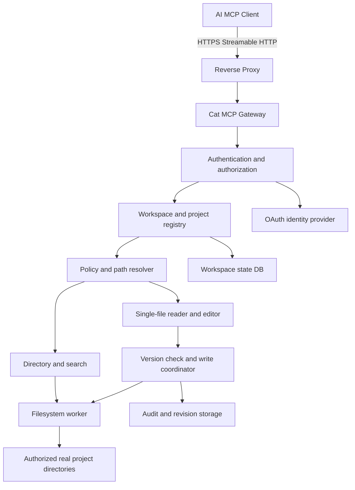
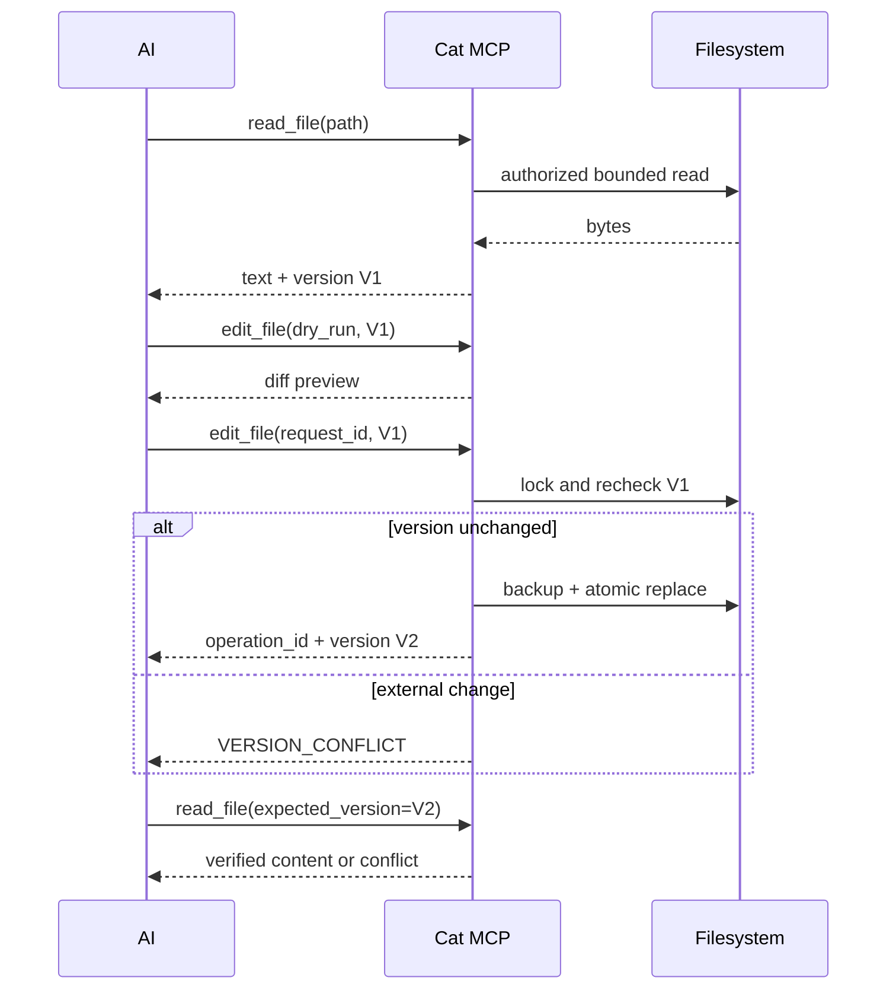

# Cat — 远程软件工程工作空间 MCP 总体需求与技术实现方案

- 版本：v1.2（多项目源码复用规划及接口版本校正；保留 v1.1 需求基线）
- 日期：2026-11-26
- 范围：需求、开源选型、系统设计、工具契约、业务流程、部署与验收。不含已实现代码或实测结论。

## 1. 背景与目标

Cat 是面向 AI 编程的远程工程文件系统服务。远端 AI 通过标准 MCP 调用直接读写公网服务器上经授权的真实工程目录，包括 Git 未跟踪、未提交文件以及非 Git 工程；不依赖 GitHub 提交作为文件交换中介。服务器负责确定性地执行文件操作，模型负责分析、设计和编程决策。Cat 不运行模型，不替代 IDE、编译器、版本控制或任务管理平台。

核心目标：以单文件为读写和编辑单位；发现多个工程，按目录深度分页浏览，搜索路径与文件内容，选择工程和当前相对工作目录，分段读取大文件，精确编辑局部内容，创建、移动、复制、删除文件及目录，查询并恢复变更。AI 能够从未知工程开始逐层理解并完成实际代码修改，而不将整个工程塞进上下文。

非目标：V1 不提供任意 Shell、SSH、联网下载、远程桌面、自动提交/推送 Git、模型执行、自动修改部署配置或生产环境。构建与测试执行以后以独立、受限的执行服务接入；文件系统权限并不等于执行权限。编辑代码后仍需独立测试及验收。

## 2. 需求规格

| ID | 优先级 | 需求 | 验收原则 |
|---|---|---|---|
| R01 | P0 | 公网 HTTPS MCP 接入 | 初始化、工具发现、调用、鉴权均通过 |
| R02 | P0 | 工程注册与发现 | 只返回当前主体有权访问的工程 |
| R03 | P0 | 层级目录浏览 | 深度、过滤、分页、排序、路径可复用 |
| R04 | P0 | 当前工程和工作目录 | 不同工作空间互不影响，支持返回上级但不能越根 |
| R05 | P0 | 单文件读取 | 整文件或按行/字节分段，返回版本、编码、行号 |
| R06 | P0 | 工程代码检索 | 文件名、路径 glob、内容字面量与正则 |
| R07 | P0 | 创建与整体写入 | 创建不覆盖；覆盖必须显式指定旧版本 |
| R08 | P0 | 精确单文件编辑 | 匹配文本或行范围或统一 diff；多处修改仅作用于同一文件 |
| R09 | P0 | 文件属性与目录操作 | stat、mkdir、rename/move、copy、trash |
| R10 | P0 | 并发控制与可恢复性 | 版本冲突拒绝；原子提交；重试不重复写 |
| R11 | P0 | 权限和审计 | 每次调用验证主体、工程、路径、动作、配额 |
| R12 | P1 | 工程概要与 Git 只读状态 | 项目类型、关键清单、HEAD、dirty 状态 |
| R13 | P1 | 变更记录、对比和回滚 | 单文件回滚保留外部后续修改 |
| R14 | P1 | 二进制文件 | 受限的分块上传下载，校验 SHA-256 |
| R15 | P2 | 符号级理解 | 定义、引用、符号概要（可选 Serena/LSP） |
| R16 | P2 | 独立构建测试 | 预定义任务、隔离执行、限时和日志分页，另行授权 |

R01 是首个门禁：必须在目标 ChatGPT 账户上实测读写，不以 MCP 服务端可运行替代客户端验收。

## 3. 多项目参考与自主实现技术路线

### 3.1 选型原则

Cat 是个人优先的公开、自托管、通用开源项目，不是某个既有业务系统的专属组件。不 fork 单一文件 MCP，不将多个完整 MCP 服务串联成运行时依赖，不复制未经审查的第三方代码。参考各项目公开实践，以统一 Python 代码库自主实现业务逻辑；直接依赖成熟通用组件（官方 SDK、ripgrep 等）。公开文档调研不是全源码审计或运行测试。每项参考在对应开发阶段固定 commit、记录许可证及具体参考文件，再以独立测试验证自己的实现。

| 参考项目 | 借鉴内容 | Cat 自主实现边界 |
|---|---|---|
| [官方 filesystem](https://github.com/modelcontextprotocol/servers/tree/main/src/filesystem) | 工具命名、根目录限制、树结构、文件 CRUD 和编辑交互 | Python 安全路径层、目录游标、单文件契约；旧版以 stdio 为主，当前 README 已描述 HTTP，接入仍需测试 |
| [j0hanz/filesystem-mcp](https://github.com/j0hanz/filesystem-mcp) | 分段读取、精确匹配、diff/patch、敏感文件过滤、撤销、结果限制 | 独立编辑算法、持久恢复、版本条件写；不运行 Node 服务，不 fork |
| [tkgstrator/local-mcp](https://github.com/tkgstrator/local-mcp) | 远程 MCP、OAuth 接入流程、目录深度、分段读取 | 官方 Python SDK 对接标准授权服务；不引入任意 shell 或共享口令式认证 |
| [Muvon/octofs](https://github.com/muvon/octofs) | 行锚点与哈希、工作目录、精确替换 | Python 工作空间和版本锚点；不引入 SSH/SFTP/shell |
| [njbrake/filesystem-mcp-server](https://github.com/njbrake/filesystem-mcp-server) | Python 与 Streamable HTTP 文件服务的组织方式 | 参考最小 Python 工具注册和部署；自主实现增强工具 |
| [Desktop Commander](https://github.com/desktop-commander/remote-desktop-commander) | 远程文件操作的客户端体验与工具说明 | 只参考公开文档及交互；其托管服务实现明确未开源，不依赖托管中继 |
| [Serena](https://github.com/oraios/serena) | 语言服务、符号级导航和编辑 | P2 可选；当前 Serena 应用 GPL-3.0-or-later 仅参考行为，优先评估 MIT SolidLSP 或标准 LSP，不进入 V1 强制依赖 |
| [Supergateway](https://github.com/supercorp-ai/supergateway) | stdio 与 HTTP 传输兼容实践 | 仅联调参考；直接由官方 Python SDK 提供协议 |

### 3.2 语言决策

| 语言 | 优点 | 代价 | 结论 |
|---|---|---|---|
| Python | 文件、文本、哈希、SQLite 标准库；官方 MCP SDK；易读、快速迭代 | 需管理 Python 环境；阻塞 I/O 不能占用异步事件循环 | 首选 |
| TypeScript | 官方 MCP 生态成熟，异步网络好 | Node/npm 工具链，类型和打包增加个人维护面 | 备选 |
| Go | 单二进制部署、并发与 I/O 性能 | 相比 Python 需更多显式代码，编辑工具实现成本较高 | 只有性能/部署证据支持时再评估 |
| Rust | 安全内存、性能、系统编程能力 | 学习及维护成本较高 | 不作为默认实现 |
| Shell | 便于安装运维 | 难以维护结构化 MCP、权限、事务和可靠错误处理 | 仅用于辅助脚本 |

文件 I/O 和网络等待是主要负载，Python 性能预计足够，须通过验收基准验证。高吞吐搜索采用 ripgrep 的成熟实现，不自行编写全文检索引擎。使用 Python 3.12+（CI 首先覆盖 3.12/3.13，实际支持版本以兼容测试为准）；不为了追逐最新版本使用未稳定的 SDK API。

| 技术 | 决策 |
|---|---|
| MCP | [官方 Python SDK](https://github.com/modelcontextprotocol/python-sdk)，优先官方 SDK v2.3.0 候选稳定版内置 MCPServer（v2 已移除 FastMCP），通过联调后固定依赖；若退回 v1 则必须明确锁定 mcp<2、使用该版 FastMCP 并重新验收；不引入独立 FastMCP 框架 |
| HTTP | SDK Streamable HTTP ASGI 应用 + Uvicorn；无需额外 FastAPI，stdio 可选 |
| 模型/配置 | Pydantic 参数与配置校验；TOML、tomllib；环境变量覆盖敏感配置 |
| 文件操作 | os、pathlib（仅路径表示）、hashlib、difflib、shutil（不得绕过安全文件层）；Linux fd-relative 安全操作 |
| 搜索 | [ripgrep](https://github.com/BurntSushi/ripgrep) 可选加速组件；标准库有界字面量搜索回退；正则不可无超时运行 |
| 状态 | sqlite3、WAL、文件备份；单进程、短事务、不引入数据库服务器 |
| 鉴权 | SDK token verifier + 成熟 OAuth 授权服务；本地 loopback 可使用受限开发模式，公网必须认证 |
| 工程 | pyproject.toml、uv.lock、uv、pytest、Ruff；类型注解、简洁函数、模块化 |
| 部署 | 原生 Python/uv、systemd 或 Docker；Caddy/Nginx 可选作为 TLS 入口 |

官方 SDK 文档：[授权](https://github.com/modelcontextprotocol/python-sdk/blob/main/docs/run/authorization.md)、[ASGI](https://github.com/modelcontextprotocol/python-sdk/blob/main/docs/run/asgi.md)；[Python os](https://docs.python.org/3.12/library/os.html) 提供 dir_fd、fsync 等能力。API 细节以锁定版本为准。文件路径安全与外部编辑竞态仍需要专门验证，不能因为 Python 有标准库就承诺安全。

### 3.3 公开开源工程规范

- 沿用仓库现有许可证；核查第三方许可，禁止不兼容复制，若引入第三方源码须记录来源 commit、许可证、版权及 NOTICE（如需）。维护 THIRD_PARTY_NOTICES.md 和依赖清单；参考设计与实际依赖分开。
- 全部示例使用虚构项目 demo-app、demo-lib、example.com、/srv/cat/projects。不得出现真实用户名、账号、IP、私有域名、内部工程名、客户数据、真实绝对路径、访问令牌或内部协作协议。公开仓库只保留与通用产品有关的设计；测试数据由程序生成。
- 提供英文 README、中文 README.zh-CN（建议）、LICENSE、CONTRIBUTING.md、SECURITY.md、CHANGELOG.md、配置示例、安装/升级/卸载说明和 API 工具文档。真实配置放仓库外，或被 .gitignore 排除；发布前检查 Git 暂存区、历史和构建产物是否含秘密，CI 运行 secret scanning（如 gitleaks）。
- 不在仓库保存实际工程目录、运行时数据库、审计日志、备份、OAuth 密钥和用户身份信息。示例配置不能直接开启未认证公网访问。
- 默认 Linux 单机、单用户 owner、多工程、多个独立 AI workspace；不实现多租户管理界面、企业组织/角色体系、集群和复杂运维。ACL 保留简单的主体/工程/路径/动作校验，为后续扩展保留接口。公网安全是硬约束，个人使用不降低权限隔离要求。

### 3.4 源码复用实施总则（v1.2）

Cat 的自主实现不是从零重新发明所有算法。每个标准任务均在第4节列出固定提交的具体代码/测试路径、拟借鉴符号、复用方式、Cat 必须补充的逻辑，在第6节列出参考实现对齐验收。任务档案中的 v1.1 原始 commit 保留用于需求追溯；本节及修订后档案是后续实现的技术细化，未变更 R01–R16 的范围。

| 复用方式 | 适用内容 | 约束 |
|---|---|---|
| 直接依赖 | 官方 Python SDK、Python 标准库、ripgrep、Pydantic、SQLite、成熟 IdP/TLS 组件 | 固定兼容版本、直接使用其稳定接口，不重复实现协议/哈希/数据库/搜索引擎 |
| 代码移植 | 官方 filesystem、j0hanz、local-mcp、octofs 等的适用文件操作、分页、精确编辑、事务组织和诊断算法 | 审阅具体源码、许可及测试；将合适实现移植为统一 Python 模块，保留必要版权与来源，不盲目逐行翻译，不导入整个上游服务 |
| 测试复用 | 官方 filesystem、SDK、octofs、CPython、ripgrep 的测试场景 | 复现行为及边界；代码复制仍须符合许可；Cat 实测必须单独记录 |
| 独立补充 | 工程注册/ACL、独立工作空间、持久幂等与事务、安全路径、备份恢复、工具契约和个人配置 | 现有候选不完整覆盖 Cat 需求，明确自建边界；共享模块只能有一个实现，不能由各工具各自复制 |

全局研发门禁：工程骨架任务完成后先执行标准任务“建立开源参考项目和依赖许可清单”（Task-R-20261126012656434-P1-New.md），随后才能引入业务参考实现。各任务在动手之前全文阅读自己列出的参考实现与相关测试（按固定提交，不默认跟踪 main），确认可采用的算法/数据结构/调用顺序及不可采用的行为；逐文件确认许可证及 SPDX，记录实际使用路径、符号、版本、移植或直接调用方式、变更点和对应测试。未读源码不得声称已复用；许可不明或安全语义不符时不得复制，说明原因并使用兼容方案。无需为了凑复用比例而引入不相关依赖。

固定参考版本和全局差异记录见 [Cat-开源源码参考基线.md](Cat-开源源码参考基线.md)。SDK v2.3.0 候选的 MCPServer、TokenVerifier 和 transport middleware 已核对源码；实际安装与协议联调仍是 P0 门禁。Remote Desktop Commander 远程托管实现非开源，其 README 仅用于连接体验参考。Serena 应用当前 GPL-3.0-or-later，不直接并入 MIT Cat，MIT SolidLSP 可独立评估；不得把整个 Serena 软件包描述为 MIT。

## 4. ChatGPT 及其他客户端接入

依据 OpenAI 当前官方说明：
- [Connecting custom MCP servers in ChatGPT](https://help.openai.com/en/articles/12584461-connecting-custom-mcp-servers-in-chatgpt)：完整自定义 MCP 读写目前适用于 Business、Enterprise/Edu；Pro 自定义 MCP 只读/获取权限，Plus 不应假定有完整读写。
- [Add custom MCP server](https://developers.openai.com/api/docs/guides/custom-mcp-server)：Plugins 可添加远程服务，支持 SSE 和 Streamable HTTP；写操作默认可能要求确认。
- [Responses API remote MCP](https://developers.openai.com/api/docs/guides/tools-connectors-mcp)：应用可将 Cat 作为远程 MCP 服务器配置，API 独立计费，审批由客户端和服务端共同控制。

**A 路线：** 公网 DNS 指向服务器 IP，可信 TLS，配置 https://cat.example.com/mcp（示例，不是实际地址）。具备权限的用户在 ChatGPT Web 的 Plugins 中选择添加自定义 MCP、输入 endpoint、配置 OAuth、检查工具、安装并在新会话选择 Cat。用测试工程依次验证 list_projects、open_workspace、read_file、write_file、edit_file。按客户端要求确认写操作，不将写工具伪装成只读来规避。

**B 路线：** 对不支持自定义写入的账户，采用 OpenAI Responses API 或其他支持完整 MCP 的客户端（例如 Codex、Claude Code）连接同一服务。API 客户端通过授权令牌配置远程 MCP，工具执行审批显式控制。此路线不意味着当前网页对话能直接调用该 MCP；如需当前网页原生使用，账户必须具备对应权限。可选官方 Secure MCP Tunnel，不是公网场景硬依赖。

MCP 使用 Streamable HTTP、标准初始化及版本协商，采用受支持 SDK；兼容 MCP 2025-era 客户端及后续版本须经集成测试。不依赖 MCP session header 一定存在或会话持久化；Cat 自身 workspace_id 是业务级上下文，与协议连接 ID 分离。若客户端不支持 elicitation，服务端返回需审批的结构化错误，由独立授权界面或客户端显式流程处理，不自动降级为允许。

协议参考：https://modelcontextprotocol.io/specification/ ，SDK：https://github.com/modelcontextprotocol/python-sdk 。

## 5. 系统架构



网关：MCP 协议、Schema 校验、工具描述、统一错误和限制。身份服务：校验 access token 的签名、issuer、audience、expiry、scope；禁止客户端自行传 user_id。工程目录由管理员配置并明确授予主体，不接受 AI 任意绝对路径。Workspace 管理负责虚拟 CWD、租期、上下文版本。文件服务负责路径解析、读取、目录和检索、写入、编辑。变更协调器执行版本检查、锁、原子写、审计和恢复。默认单进程、单 owner、多工程，逻辑隔离；公网挂载仅授权目录，专用非 root 用户。不同信任域才增设独立 worker/容器；不声称单进程具有 OS 级多租户隔离。审计/备份在工程之外独立存储。MCP server 不使用进程级 chdir。

## 6. 工程与工作空间模型

示例主机目录：
```text
/srv/cat/projects/
  demo-app/
    server/
    web/
    doc/
  demo-tools/
  demo-lib/
/var/lib/cat/   # 状态、日志和恢复对象，不暴露给工具
```

管理员显式注册工程，或者在配置的 discovery_root 下扫描一级目录作为候选，需经管理员批准方可读写。list_projects 仅返回授权工程的 ID、显示名、根相对名称、权限和摘要，不返回其他工程真实路径。支持多个 discovery_root；ID 不依赖目录名。目录可含非 Git 工程。

数据模型：
- Project(id, display_name, root_path, root_identity, enabled, policy_id, generation)
- Grant(subject, project_id, scopes, allowed_prefixes, expires_at)
- Workspace(id, subject, project_id, cwd, cwd_version, project_generation, expires_at, status)
- Operation(id, subject, workspace_id, request_id, input_digest, path, status, before_version, after_version, started_at, completed_at)
- Revision(id, operation_id, before_blob_ref, after_hash, mode, expires_at)
- Audit(event_id, subject, project_id, workspace_id, action, canonical_relative_path, outcome, bytes, timestamp, correlation_id)

Workspace ID 为不可预测随机 ID，必须绑定登录主体；每次请求重验授权和工程 generation。建议空闲 2 小时、最长 24 小时（可配置），恢复时重新 open。工作空间状态保存在 SQLite，不依赖模型记忆或 HTTP 连接。不同 AI 即使使用同一账号，也分别打开独立 workspace，避免 CWD 串扰。

路径规则：
1. 参数 path 默认相对 cwd，可用 path_base=root 从工程根定位；不接受服务器绝对路径、URL、NUL、Windows 驱动器/UNC 等歧义形式。
2. CWD 是逻辑路径；set_cwd 支持 '.'、'..' 和子目录，但不得越出工程根。永远不切换系统进程工作目录。
3. 每次返回 project_id、workspace_id、cwd、cwd_version、规范化项目相对路径。写调用必须传 cwd_version 或显式 path_base=root。CWD 改变则旧相对写请求返回 CWD_CONFLICT。
4. symlink 默认禁止穿越及写入（可以显示其为链接但不返回外部目标）；拒绝特殊设备、FIFO、socket、未获授权子挂载、危险 hardlink。Linux 使用 fd-relative / openat2 RESOLVE_BENEATH、NO_SYMLINKS、NO_MAGICLINKS（视支持情况）和安全父目录 fd；不能仅靠 realpath 检查后再按字符串访问。Python 使用 os.open(..., dir_fd=..., O_NOFOLLOW|O_DIRECTORY) 逐级打开父目录，文件操作使用安全目录 fd；Linux openat2 等增强按需采用经过审查的薄封装。注意仅检查字符串或逐级 fd 并不自动消除挂载及目录重命名竞态；结合 OS 级隔离、禁止不可信进程搬移根及祖先、测试边界。不满足边界则拒绝公网写。
5. 根目录、目录祖先及目的路径全部授权校验；工程根本身不允许删除、移动或覆盖。

## 7. MCP 工具设计（V1 拟定契约）

所有工具名称使用 cat_ 前缀；业务参数 workspace_id 必填（发现/open 除外）；所有文件正文读取、写入和编辑一次只针对一个文件。目录浏览与搜索可返回多条元数据或匹配行，不批量返回文件正文。工具不允许任意指令字符串。表中 ? 表示可选，实际 Schema 使用 additionalProperties:false、类型/枚举/范围约束。

| 工具 | 核心输入 | 输出/作用 | 权限 |
|---|---|---|---|
| cat_get_capabilities | 无 | 协议/工具版本、限额 | read |
| cat_list_projects | query?, cursor?, limit? | 授权工程列表 | discover |
| cat_open_workspace | project_id, cwd? | workspace_id、cwd_version | read |
| cat_get_workspace | workspace_id | 当前上下文、期限 | read |
| cat_set_cwd | workspace_id, path, expected_cwd_version | 新 cwd/版本 | workspace |
| cat_close_workspace | workspace_id | 关闭 | workspace |
| cat_project_info | workspace_id | manifest 名称、语言估计、Git 概况 | read |
| cat_list_directory | path?, path_base?, depth?, cursor?, limit?, include?, exclude? | 目录树条目及分页 | read |
| cat_stat | path, path_base? | type/size/mtime/version/encoding | read |
| cat_find_files | path?, glob, cursor?, limit? | 文件名、相对路径 | read |
| cat_search_text | path?, query, mode, include?, exclude?, context_lines?, cursor?, limit? | 匹配路径、行号、短上下文 | read |
| cat_read_file | path, start_line?, end_line?, max_bytes?, expected_version? | 单文件文本、行范围、版本 | read |
| cat_write_file | path, content, mode=create/replace, expected_version?, request_id, cwd_version? | 写入回执、新版本 | write |
| cat_edit_file | path, expected_version, edits, dry_run?, request_id?, cwd_version? | diff 或新版本 | write |
| cat_apply_patch | path, patch, expected_version, dry_run?, request_id?, cwd_version? | 单文件严格补丁 | write |
| cat_create_directory | path, parents?, request_id, cwd_version? | 创建回执 | write |
| cat_move_path | source, destination, expected_version, request_id, cwd_version? | 不覆盖目标的重命名/移动 | write |
| cat_copy_file | source, destination, expected_version, request_id, cwd_version? | 不覆盖的单文件复制 | write |
| cat_trash_path | path, expected_version, recursive?, request_id, cwd_version? | 软删除/回收记录 | delete |
| cat_list_changes | cursor?, limit? | 当前工程授权范围内操作记录 | audit |
| cat_get_operation | request_id | 已执行、失败、进行中或未知 | read |
| cat_diff_file | path, revision_id?, git_base? | 有界差异 | read |
| cat_restore_file | path, revision_id, expected_version, request_id, cwd_version? | 条件恢复或冲突 | restore |

二进制 P1：cat_begin_upload、cat_upload_chunk、cat_finish_upload、cat_read_chunk、cat_abort_upload，均绑定单文件和授权 workspace；严格大小/块序号/偏移/哈希校验，finish 才原子提交。超大文本也可用分块方式创建，避免单次上下文限制。Git P1：cat_git_status、cat_git_diff（只读，不执行 commit/push）。P2 符号：cat_list_symbols、cat_find_definition、cat_find_references，返回路径和范围，由 cat_read_file 读取真实内容。

工具注解：只读工具 readOnlyHint=true，写工具明确 false；覆盖、删除、恢复等 destructiveHint=true，不能把 dry_run 分支视为整个写工具只读；稳定请求 ID 下的写入幂等由服务端保障，注解按真实语义配置。工具描述说明何时调用、返回值与失败恢复。可提供独立只读 preview 工具，避免混淆审批。

### 7.1 目录分页及搜索

depth=0 只返回目录自身元数据，depth=1 列直接子项，最大 depth=8；默认 1。条目含 path、name、type、depth、size、mtime、可选 child_count（未知时 null）。按规范化路径稳定排序，使用有界快照/游标；cursor 与主体、工程、参数和快照绑定，过期返回 CURSOR_EXPIRED，调用方重启扫描。不静默截断：has_more、next_cursor、truncated_reason 必须明确。工程树不含文件正文。默认忽略 node_modules、target、dist、build、.git 及 .gitignore 匹配项；允许显式访问非敏感被忽略源文件，但安全 denylist 永远优先。搜索支持 literal/regex、路径 glob、case、上下文行，输出路径、行号、短文本、版本；RE2 或 rg 固定 argv，不拼接 shell，不跟随符号链接，禁止 PCRE2 等高风险模式，限制扫描字节、时间及结果数。

### 7.2 读取与版本

示例参数：
```json
{"workspace_id":"ws_example","path":"src/main/java/App.java","path_base":"root","start_line":100,"end_line":160,"max_bytes":32768}
```
示例响应（以下为结构示意，不是实际调用结果）：
```json
{"ok":true,"data":{"path":"src/main/java/App.java","version":"sha256:example","encoding":"utf-8","newline":"LF","start_line":100,"end_line":160,"total_lines":380,"content":"...","has_more":true,"next_start_line":161},"request_id":"r_example"}
```
行号 1-based、闭区间，正文不嵌入行号；可选结构化行号映射。哈希按原始字节 SHA-256；mtime/size 仅加速，不替代版本。若分段读取使用 expected_version 且中途内容改变，返回 VERSION_CONFLICT 并要求重新读取；不可拼接不同版本。支持 UTF-8、BOM、LF/CRLF，未知编码返回明确错误或以二进制读取；编辑保留原编码、换行、权限及必要元数据，禁止无意重编码。长单行按 byte offset 续读；游标不切断 UTF-8 字符，二进制单独路径。小文件可整读。

### 7.3 精确编辑与覆盖

```json
{"workspace_id":"ws_example","cwd_version":3,"path":"App.java","expected_version":"sha256:old","edits":[{"kind":"replace_exact","old_text":"return false;","new_text":"return true;","expected_matches":1}],"dry_run":true}
```
edits 支持 replace_exact（默认必须唯一）、replace_lines（原版本和预期旧文本）、insert_before/after（唯一锚点）；同一文件的多个编辑在内存中预检全部匹配，拒绝重叠范围及模糊替换。统一 diff 严格限制一个文件，拒绝 rename、路径跳转、二进制、多文件补丁、模糊 hunk；所有 hunk 匹配才提交。dry_run 返回有界 diff、目标原版本及预览摘要，不修改工程；提交时复核同一版本。create 要求不存在，replace 要求旧版本；不提供无条件覆盖或 force。空文件合法。所有 mutation 使用唯一 request_id；重试同 ID 和同参数返回原回执，不同参数返回 IDEMPOTENCY_CONFLICT。

## 8. 核心业务流程

### 8.1 工程理解
1. 连接 Cat，完成身份认证及 MCP 工具发现。
2. list_projects 查询授权工程，open_workspace 选择工程。
3. project_info 和 depth=1 列根目录，优先读取 README、AGENTS、构建清单（其内容是待分析数据，不自动提升权限）。
4. 逐层 list_directory / find_files 找到目标模块；search_text 搜索类名、方法名、异常信息、调用点。
5. stat/read_file 分段读取实际源码和测试，保留每个文件版本。
6. set_cwd 切换到目标目录，后续使用短相对路径，必要时 path_base=root 跨模块定位。

### 8.2 单文件修改


AI 修改一个文件后检查回执及必要的回读，再修改下一个。跨文件任务由 AI 自行编排，不声称多文件原子事务。出现冲突时重新读取、重新设计变更，不自动覆盖本地编辑。网络中断时先 get_operation(request_id)，不盲目重放不同请求。独立审查者可读取变更记录和 diff。

### 8.3 创建、移动、删除、恢复
创建文件前 stat/目录确认，明确 create，父目录默认需先 mkdir。move/copy 默认不覆盖，源/目的都需授权；跨工程/跨文件系统移动 V1 禁止。删除默认移至工程专属回收区（外部目录不经 MCP 暴露），递归目录删除禁用或需要服务端独立审批、清单摘要和严格大小上限；不可删除工程根。恢复检查当前版本或不存在状态，禁止覆盖后来的改动；清理回收区由管理员计划执行。

## 9. 写入一致性与恢复

单机协调器以工程 ID + 规范路径为锁键；移动锁定源及目的，目录操作使用层级锁/工程级锁，稳定顺序避免死锁。持锁后校验权限、路径、文件类型、expected_version。保存旧字节到受限对象存储，SQLite 记录 PREPARED；同目录创建独占临时文件，写入、校验、保留许可属性、fsync，原子 rename（新建使用 no-replace 语义），fsync 父目录；记录 COMMITTED、新版本及审计，再返回成功。失败清理临时文件，不宣称已写入。重启扫描 PREPARED：按 before/after hash 和目标状态判断已提交、未提交或 IN_DOUBT；无法确定时冻结该路径等待管理员，不盲目覆盖。备份保留 7 天和配额均为建议默认值，生产按数据策略调整。

**并发边界：** 文件锁能约束 Cat 客户端，不能保证任意本地进程遵守锁。普通 POSIX rename 无通用原子 compare-and-swap。对外部编辑者需要独立工作树/统一写协调协议才能提供严格无丢失保证；共享 live workspace 模式只能在替换前再次核验、写后检查和保留备份，存在极窄 TOCTOU 窗口，不能承诺绝对无冲突。默认生产采用每任务隔离工作树或专用受控工程；需要修改正在被 IDE 编辑的真实工作树时，由用户接受该边界并协调写入。Cat 不负责自动 Git 合并。

## 10. 公网安全与数据保护

- 网络：仅开放 443，反向代理到 loopback/private container；TLS、Host/Origin 校验、请求体上限、认证限速。对支持的客户端使用标准 MCP OAuth 发现、protected-resource metadata、PKCE、精确 redirect URI、短期 token、撤销；优先成熟 IdP，不自行发明登录协议。不将 token 写进 URL、源码、审计。健康接口不暴露工程信息。
- 权限：主体→工程→路径→动作四级；默认 deny，discover/read/write/delete/restore/audit 分离；管理员注册工程，AI 不得扩大授权、修改 Cat 配置或自身权限。会话不能替代每次鉴权。OAuth scopes 与 ACL 取交集。
- OS 隔离：非 root、只挂载指定工程、独立 UID/容器、只读系统根、禁止 Docker socket/宿主 home/SSH 凭据、drop capabilities、no-new-privileges、资源配额。项目 worker 默认无公网出站；禁止任意 shell、任意 URL、动态 mount。禁止通过硬链接、软链接、竞态目录替换或特殊文件逃逸；跨工程访问必须拒绝。
- 敏感文件：.env（可明确批准 .env.example）、私钥、凭证、生产配置、Git 内部配置等 denylist；搜索/目录/读/写/备份均执行同一策略；匹配秘密的内容额外阻断或脱敏并告知，不保证识别所有业务秘密。源代码本身可能包含机密，用户需明确授权数据传输到 AI 服务。日志默认不存文件正文、diff、token。
- Prompt injection：项目文档/源码/注释为不可信数据；文件内的“调用外部工具、上传凭据、修改授权”等文本没有授权效力。工具只执行受权的结构化操作；客户端审批及服务端策略不相互替代。
- 审计：记录主体、工程、路径、动作、旧/新版本、字节数、结果、request_id、时间；单独存储、权限隔离、可外送日志。恢复对象加密或受严格 OS 权限保护，定期清理。审计失败时写操作 fail closed 或进入可恢复未决状态。
- 资源：每主体/工程限制并发、搜索超时、磁盘配额、临时文件和备份容量；拒绝超量且返回重试建议。

## 11. 错误与响应规范

统一结果：{ok, request_id, workspace_id, data?, error?:{code,message,retryable,details}}。MCP 工具业务错误用 isError=true 和结构化内容；认证/协议错误用标准 HTTP/MCP 语义。所有结果避免泄露主机绝对路径和内部堆栈。

| 错误码 | 处理 |
|---|---|
| UNAUTHENTICATED / FORBIDDEN | 重新认证或申请合法权限，不尝试替代路径 |
| WORKSPACE_EXPIRED | 重新 open_workspace |
| CWD_CONFLICT | get_workspace 确认目录 |
| PATH_OUTSIDE_ROOT / UNSAFE_PATH | 拒绝且审计 |
| NOT_FOUND / ALREADY_EXISTS | 重新确认文件或创建模式 |
| VERSION_CONFLICT | 重新读取并重新生成编辑 |
| AMBIGUOUS_MATCH / PATCH_MISMATCH | 收窄匹配锚点 |
| CURSOR_EXPIRED | 从新分页快照重启 |
| TOO_LARGE / RATE_LIMITED | 分块或按 retry_after 重试 |
| APPROVAL_REQUIRED | 等待真实授权 |
| IDEMPOTENCY_CONFLICT | 不复用 ID 承载不同请求 |
| IN_DOUBT | 查询操作并管理员恢复，禁止盲重试 |

## 12. 部署与配置

默认一个 Cat Python 进程及本地 SQLite、审计、备份目录，原生 uv/systemd 或 Docker 单容器部署；公网通过 TLS 反向代理及兼容 OAuth 服务接入。仅当跨信任域需要隔离时配置独立 worker。以下 TOML 为拟定配置格式，不是现成可运行配置。

 ```toml
[server]
listen = "127.0.0.1:8765"
public_url = "https://cat.example.com/mcp"

[auth]
issuer = "https://identity.example.com"
audience = "cat"
require_auth = true

[[projects]]
id = "demo-app"
root = "/srv/cat/projects/demo-app"
access = ["read", "write"]

[[projects]]
id = "demo-lib"
root = "/srv/cat/projects/demo-lib"
access = ["read"]

[limits]
directory_depth = 8
page_entries = 200
max_tool_response_bytes = 65536
max_inline_write_bytes = 262144
max_search_seconds = 10
max_search_results = 100
workspace_idle_seconds = 7200
max_concurrent_per_subject = 4
backup_retention_days = 7

[security]
allow_shell = false
follow_symlinks = false
allow_recursive_delete = false
deny_sensitive_files = true
```

实际授权由独立 ACL 配置或管理面定义，access 是项目允许动作上限，不是所有人自动获得权限。配置示例不能包含真实 IP、令牌或生产路径。管理员安装步骤：创建专用用户与测试工程→配置 ACL/IdP→部署镜像与挂载→证书和 DNS→MCP Inspector 测试→目标 ChatGPT 账户端到端→启用受限真实项目。升级锁版本、备份状态库、运行迁移、健康检查与回滚；SQLite 必须使用本地可靠磁盘，V1 不支持横向扩展或多 worker 并发写；如未来确有需求再单独设计。

性能指标为目标而非实测：10 万文件测试工程，depth=1 目录页 P95 小于 500ms、64 KiB 文本读 P95 小于 300ms（服务端暖态、不含公网）；搜索 10 秒内返回结果或明确超时；单次结果默认 64 KiB，可调但不得超客户端限制。缓存目录与索引仅用于加速，写前必须查真实文件。无需预建全工程向量索引，V1 以实时文本搜索为主。

## 13. Python 项目结构与实现规则

```text
cat/
  README.md
  README.zh-CN.md
  LICENSE
  CONTRIBUTING.md
  SECURITY.md
  THIRD_PARTY_NOTICES.md
  CHANGELOG.md
  pyproject.toml
  uv.lock
  .gitignore
  config.example.toml
  docs/
  src/cat_mcp/
    __init__.py
    __main__.py
    server.py           # MCP 注册与 transport
    config.py           # 配置校验
    auth.py             # token 验证和授权
    projects.py         # 工程注册与发现
    workspace.py        # workspace_id、虚拟 cwd
    schemas.py          # 输入输出模型
    errors.py           # 统一错误
    fs/
      paths.py          # fd-relative 路径安全
      directory.py      # 树和分页
      reader.py         # 单文件、分段读取
      editor.py         # 精确替换和单文件补丁
      writer.py         # 原子写、移动、回收
      search.py         # 有界搜索与 ripgrep 适配
    state.py            # SQLite
    operations.py       # 锁、版本、幂等、恢复
    audit.py            # 审计与历史
  tests/
    unit/
    integration/
    security/
    e2e/
  deploy/
    Dockerfile
    compose.example.yml
    cat.service.example
  .github/workflows/
    ci.yml
```

V1 采用模块化单体，避免层层抽象及重型依赖注入框架。项目 import 名称 cat_mcp；CLI 拟使用 cat-mcp，避免与系统 cat 命令冲突。包发布名称需在发布前核实是否可用，不默认已注册。工具 handler 只做身份上下文、参数校验、业务调用及结果映射；业务文件访问全部通过安全路径层；状态/事务使用同一协调器。文件 I/O 在有界线程池运行，搜索使用固定 argv、受控子进程和超时；禁止 shell=True。ripgrep 仅在 OS 限定的工程范围内运行，且结果按统一路径与敏感数据策略重验；若无法避免进程读取禁止数据，改用安全文件描述符逐文件扫描。标准库 fallback 只提供有界字面量查询，正则不可用时返回能力限制，不静默采用无超时 Python re。数据库不跨线程共享未受保护连接，不持有数据库事务等待网络。

代码实现优先清晰、短小、可独立测试；不要为了设计模式新增类。对安全、并发与恢复必须有明确注释、测试及错误语义。上游项目不是运行时依赖；严禁通过其未经审核的工具绕开 Cat 安全层。

## 14. 分阶段实施计划

| 阶段 | 工作 | 通过条件 |
|---|---|---|
| P0-A 接入验证 | 初始化公开 Python 包、许可证/CI/配置模板；固定参考项目版本和许可；临时测试工程、HTTPS/OAuth、最小读写 MCP；ChatGPT/API 实测 | 有真实客户端读写回执，确认账户路线 |
| P0-B 只读基座 | registry、ACL、workspace、cwd、目录分页、stat、分段读、搜索 | 两个工程/两会话隔离，大工程浏览与搜索通过 |
| P0-C 写能力 | 单文件创建、覆盖、精确编辑、patch、mkdir、move/copy/trash；版本、锁、审计、恢复 | 并发冲突、断电/重试、权限和路径攻击测试通过 |
| P1 工程增强 | 变更查询、diff、恢复、Git 只读、二进制分块、运维安装 | 可恢复删除、客户端分页、部署升级回滚验证 |
| P2 扩展 | Serena/LSP；独立构建测试任务白名单 | 语言服务与执行隔离独立验收 |

P0-A 与 P0-B 可有限并行（核心契约先固定）；P0-C 必须在安全文件后端、ACL 和版本契约稳定后实施。正式公网发布须在安全测试通过之后。Cat 的最小可用版本不需要实现 IDE 全量能力或语义索引。

## 15. 验收测试矩阵

| 场景 | 必须结果 |
|---|---|
| 两个项目、两个 AI 并行打开 | CWD 不串，权限正确，不能猜 ID 越权 |
| 100k 文件目录、不同 depth、分页 | 不丢页、不重复；截断可见 |
| UTF-8/CRLF/BOM/空文件/超长行 | 读取精确，编辑保留格式 |
| 修改未提交文件与非 Git 工程 | 真实文件变更，无强制 commit |
| 同一文件两个版本相同的并发写 | Cat 内只有一方成功，另一方冲突 |
| 外部 IDE 更改旧版本 | 检测到则拒绝；记录共享模式竞态限制 |
| 精确文本重复、patch 半失败 | 文件内容完全不变 |
| 请求提交后网络中断、同 ID 重试 | 原回执、无二次写入 |
| 进程在 PREPARED/rename/COMMITTED 间崩溃 | 恢复或 IN_DOUBT，不静默破坏 |
| ../、symlink、hardlink、FIFO、目录竞态 | 拒绝且无越权访问 |
| 未授权令牌、过期、撤销、错误 audience | 拒绝且无项目数据泄露 |
| 敏感文件、隐藏路径、搜索命中凭据 | 拒绝或安全脱敏，不通过其它工具绕过 |
| 删除/恢复后用户又修改 | 恢复拒绝，不覆盖新变更 |
| ChatGPT 工具审批拒绝 | 工程不变，真实失败反馈 |
| Linux amd64/arm64 | 安装、协议和文件操作均实测 |
| 备份/日志磁盘满 | 明确错误，写入不进入不可追踪状态 |

验收数据使用专用测试目录，不对生产工程进行破坏性测试。单元、集成、安全、端到端均为后续任务；本方案不声明已经通过任何测试。

## 16. 风险与待确认事项

1. ChatGPT 套餐及工作空间是否支持自定义写工具是最大前置风险；无真实 endpoint、OAuth 配置及目标账号权限，当前无法完成联调。
2. 已固定参考仓库 commit、核对目录树并抽查关键源码；尚未完成所有参考文件的逐行审计、许可证逐文件核验和运行测试。各任务必须在实现前完成指定参考阅读和许可检查；设计参考不等于安全验证。
3. 默认 Linux、Python 3.12+、OAuth、单 owner、多工程及单进程持久状态；这些属于可调整的通用产品设计，实际支持矩阵需实测。
4. 共享本地文件与外部编辑器存在竞态，严格保证依赖统一协调或隔离工作树；这是需要确认的运行模式。
5. 文件读写与 Shell/编译执行分离是本方案主动收敛的边界。若要允许 AI 独立编译测试，应增加单独受控执行服务，不暴露任意 Shell。
6. 公开发布前须扫描全仓及 Git 历史；当前文档只使用通用虚构示例。历史提交不因文件更新而消失，发现秘密须撤销凭据并由维护者决定历史清理方案。

## 17. 结论

Cat 的价值不是重新实现已有文件操作，而是把成熟文件 MCP 能力组织为公网可授权、具备工程上下文、可控上下文开销、单文件可靠写入、可审计恢复的工作空间服务。先验证目标 MCP 客户端的真实接入，再综合多个开源项目的实践，以 Python 自主实现完整工具契约，直接依赖官方 MCP SDK 与成熟通用组件。GitHub 仍可用于版本管理，但不再是每次文件读取和修改的必经通道。
